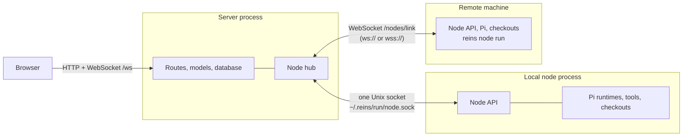
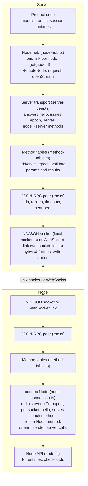
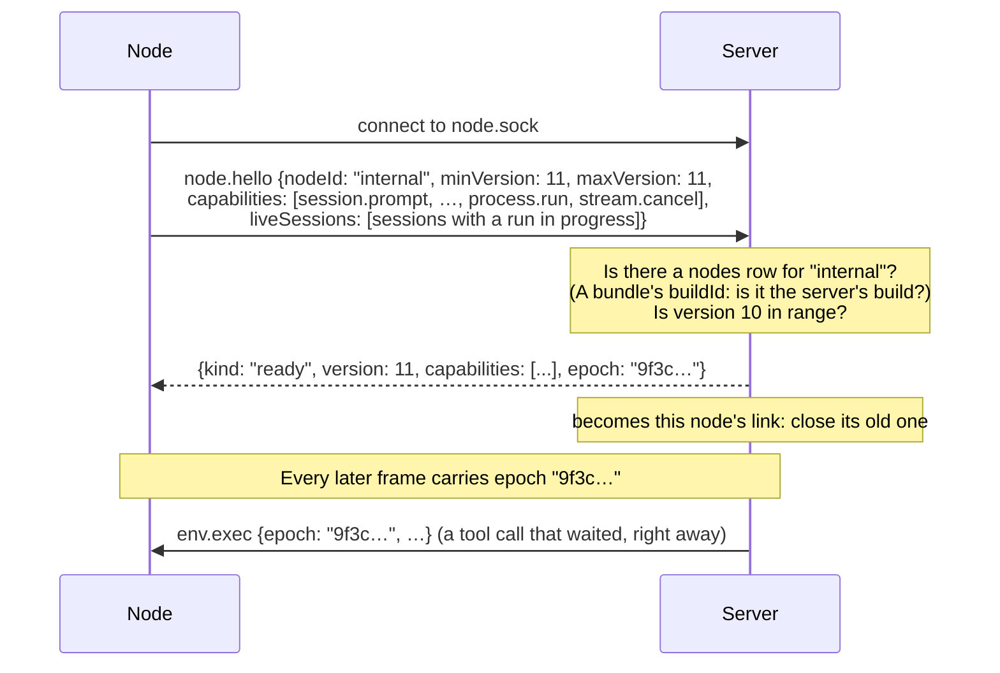
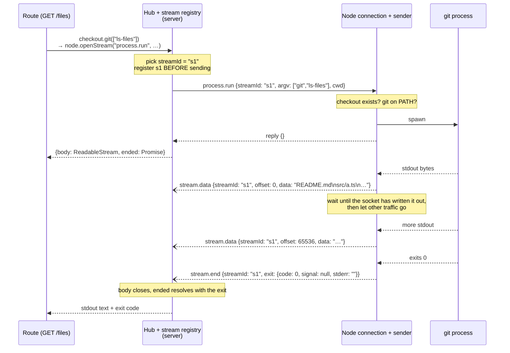
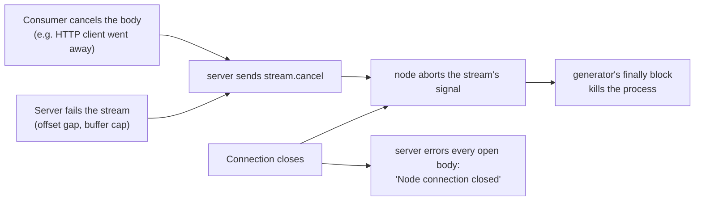
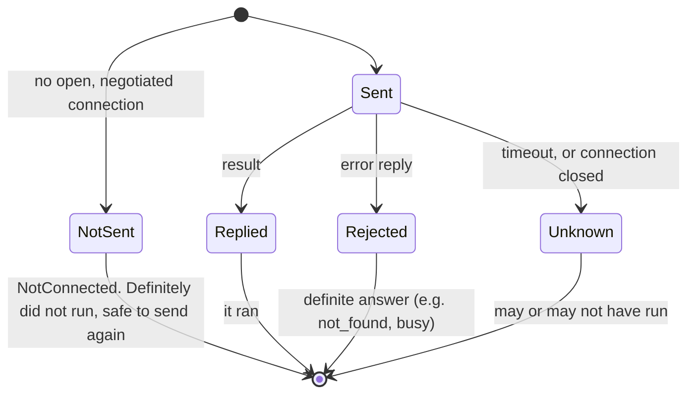
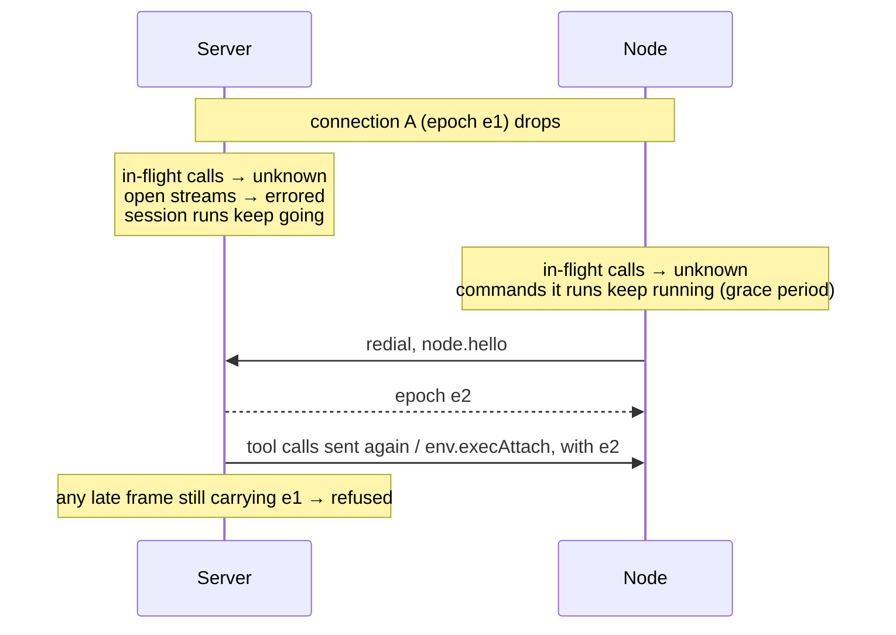

# The node link

How the Reins server and a node exchange messages, from bytes on a socket up to "the server runs `git ls-files` on the node". Each topic starts with a plain explanation and ends with the exact rules (limits, error codes, timeouts) under **Details**.

This doc covers the link itself: the socket, framing, JSON-RPC, negotiation and epochs, the heartbeat, frame caps, wire errors, the method tables, streams, reconnecting, hot reload and test links. What the server and node *say* over it (submitted work, the tool host, storage, credentials, fencing, crash recovery) is in [node-contract.md](node-contract.md).

## The big picture

There are two kinds of process. The **server** has the database, the browser UI and the credentials. A **node** runs the agent (Pi) and holds the checkouts the agent works in. They share nothing in memory and meet only on a link: the local node, on the server's machine, on one Unix socket, `~/.reins/run/node.sock`; a remote node, paired with the server, on a WebSocket at `/nodes/link` on the server's HTTP server (*The WebSocket link*).



Both sides call each other over that socket:

| Direction | What it is for | Examples |
|---|---|---|
| Server → node | "Do something on your machine" | run a prompt, abort, list skills, run `git`, list a directory |
| Node → server | "I need something only the server has" | read or save session storage, get a credential, fetch an attachment, report that a run started or finished |
| Node → server, one way | "Here's live output, no reply needed" | agent events for the browser, stream chunks |

The node keeps nothing on disk (its data directory only holds file uploads it has not finished writing). Every time Pi reads or saves session history, the call goes back over the socket to the server's database. That is why the link carries far more node→server traffic than you might expect.

## Glossary

The code uses these words precisely. Here is what each one means.

| Word | Plain meaning |
|---|---|
| **Link** / **connection** | One open socket between the server and one node. When it drops and the node redials, that is a new connection. |
| **Frame** | One complete message on the socket. On the local link a frame is one line of JSON; on the WebSocket link, one text message. |
| **NDJSON** | "Newline-delimited JSON": the bytes on the socket are JSON objects, one per line. |
| **JSON-RPC** | A standard JSON shape for messages that are *requests* (expect an answer), *replies*, or *notifications* (no answer). |
| **Peer** | The code on each end that speaks JSON-RPC: it sends requests, matches replies to them, and dispatches incoming requests to handlers. The same peer code runs on both sides. |
| **Method** | A named message type, like `storage.read` or `session.prompt`. Each one has a params schema and, for requests, a result schema. |
| **Method table** | The list of methods one side serves, with their schemas (`nodeMethods`, `serverMethods`). It is the single definition of the wire API. |
| **Request** / **reply** | A message that expects an answer, and that answer. The reply is matched to its request by an `id`. |
| **Notification** | A one-way message with no `id` and no answer. Fire and forget. |
| **Hello** / **negotiation** | The node's first request on a new connection (`node.hello`): "I am node X, I speak protocol version 6, I can do these things." The server answers with an epoch. |
| **Capability** | A server→node method the node says it supports in its hello. The server only calls methods the node listed. |
| **Epoch** | A random ID the server gives each connection at hello. Every later message carries it, so a message from an old, replaced connection is recognised and refused. |
| **Heartbeat** | `node.ping` notifications every 10 s. If one side hears nothing at all for three intervals (30–40 s), it decides the other end is dead and closes. |
| **Hub** | The server-side object (`state.nodes`) that owns all node connections and is how product code talks to nodes. |
| **Request-now** | A call that is never queued: if the node is offline it fails immediately (`unavailable`). Every server→node call works this way: `fs.list`, `fs.read`, `fs.write`, `process.run`, `checkout.environment`, the tool host's (which retries what is safe to repeat, *When things go wrong*). |
| **Outcome unknown** | A request was sent, but no reply came back (timeout, or the connection dropped). It may or may not have run on the other side. |
| **Stream** | A way for the node to send output that is too big or too long-running for one reply, as a series of chunks. |
| **Backpressure** | Slowing a sender down so it does not produce faster than the receiver (or the socket) can take. |
| **Drained** | The socket has written out everything queued to it. |
| **Fencing** | The server refusing a node's call about a session that does not belong to that node. |

## The layers

Each layer only knows about the one below it. A message passes down through every layer on the sending side and back up through every layer on the receiving side.



The NDJSON socket and the WebSocket link adapter, the peer, the method tables and the hello's schemas are shared code in `@reins/node-protocol`. The server transport, the hub and product code live in `packages/backend`. The node end of the connection, `connectNode`, is one module in `packages/node` beside the Node API ([ADR-027](../adr/027-node-end-of-the-connection-in-the-node-package.md)): it takes a `Node` and a `Transport` (the bottom layer, as an adapter) and keeps the node linked to its server.

Only the bottom layer knows about Unix sockets or WebSockets. Everything from the peer up needs just a `WireSocket` (send a text frame, receive frames, close), so the remote link (*The WebSocket link* below) reuses every layer above it, authentication included ([ADR-012](../adr/012-ndjson-unix-socket-local-link.md), [ADR-023](../adr/023-node-pairing-and-challenge-authentication.md); *Details: authentication* below).

### 1. The socket: bytes ⇄ lines

`packages/node-protocol/src/local-socket.ts` (`createNdjsonSocket`)

A Unix socket is a pipe of bytes with no message boundaries. One read might return half a message, or three and a half. This layer turns bytes into whole messages and back:

- **Sending:** it takes a JSON string, appends `\n` and writes the bytes. If the OS will not accept them all right now (its buffer is full), the rest wait in a **write queue** and go out when the OS signals `drain`. `drained()` returns a promise that resolves once that queue is empty. Streams use it for pacing (see *Streams*).
- **Receiving:** it collects bytes until a `\n`, decodes that line as UTF-8 and hands it up as one frame. A line longer than the frame cap closes the connection, so a broken peer cannot make it buffer forever.

```text
bytes from OS:  {"jsonrpc":"2.0","method":"node.pi │ ng","params":{}}\n{"jsonrpc":...
                                                    ↑ one read ended mid-frame
frames out:     {"jsonrpc":"2.0","method":"node.ping","params":{}}
```

Each server handler load listens on the socket (`nodes/local-socket.ts` in the backend, bound by the load's `start` in `server.ts`) and hands each new connection to its hub (`state.nodes.accept`). The node dials it (`unixTransport`, `packages/node/src/local-link.ts`). Both wrap their Bun socket in one of these. Tests skip this layer and use an in-memory pair of sockets (see *Test links*).

**Details: framing.**

- Each frame is the UTF-8 of one `JSON.stringify` string followed by `\n`. `send` rejects a frame containing a raw newline (`JSON.stringify` never produces one).
- The receiver splits on the newline byte, which never occurs inside a multi-byte UTF-8 character, so a frame split anywhere (mid-character included) is reassembled. One chunk may carry several frames; they are delivered in order. Each frame is decoded whole with a fatal decoder: invalid UTF-8 closes the connection.
- A partial frame that crosses the cap closes the connection, so buffering is bounded by the cap.
- The outbound queue is not capped. A peer that stops reading is closed by the heartbeat, and streams pace themselves with `drained()`.
- Closing either end drops queued bytes and closes the peer; in-flight calls fail with outcome unknown.

**Details: endpoint and permissions** (`nodes/local-socket.ts`).

- Default path `~/.reins/run/node.sock` (`defaultLocalNodeSocketPath()`). It is not under `REINS_DATA_DIR`, so both sides agree on it without configuration. `REINS_NODE_SOCKET` overrides it for both processes.
- The path must be absolute and at most 103 bytes (the OS limit on socket paths).
- The parent directory is created 0700; an existing one must be owned by the user and not group- or world-writable. The socket is chmodded 0600. **These file permissions are the local link's authentication**: only the same OS user can connect.
- On startup: a path that exists and is not a socket fails; a socket something still accepts on fails ("Another process is already listening on the node socket"); a stale socket left by a crashed server is removed.
- The listener is separate from the browser HTTP/WebSocket server.

### 1b. The WebSocket link (remote nodes)

Server: `packages/backend/src/nodes/node-link.ts` (`createNodeLinks`). Node: `packages/node/src/remote-link.ts` (`webSocketTransport`). Both wrap their WebSocket in `createWebSocketLink` (`packages/node-protocol/src/websocket-link.ts`).

A remote node is on another machine, so it cannot open the server's Unix socket. It dials a WebSocket at `/nodes/link` on the server's own HTTP server instead: `ws://` for an `http://` server URL, `wss://` for `https://` (`nodeLinkUrl`), under the server URL's path. The private network carries the transport security, so TLS is whatever the deployment provides. Everything above this layer is the same as on the local link; the only difference that matters is that **every connection must authenticate** as a paired node before its hello is answered (*Details: authentication*).

A WebSocket already delivers whole messages, so there is no byte framing to do: one frame is one text message.

```mermaid
sequenceDiagram
    participant N as Remote node (reins node run)
    participant P as Process owner (server-process.ts)
    participant L as Handler load (node-link.ts, hub)
    N->>P: GET /nodes/link, Upgrade: websocket
    P->>L: fetch → handleFetch → route (routes/nodes.ts) → state.nodeLinks.upgrade
    Note over L: origin from the request (ADR-024)<br/>handlers go in the upgrade data
    L-->>P: server.upgrade(req, {data: {handlers}})
    P->>L: open(ws) → handlers.open
    L->>N: node.authenticate {challengeId, nonce} (the first frame)
    N->>L: node.hello (at once; answered after the challenge)
    N-->>L: {nodeId, signature}
    L-->>N: {kind: "ready", version, capabilities, epoch} (or update: ADR-025)
```

**Who owns the socket.** The process owner (`server-process.ts`) owns the HTTP server, so it performs every upgrade, but it keeps no node-link logic: a socket whose upgrade data carries its own handlers (`UpgradeData` in `state.ts`: `open`, `message`, `drain`, `close`) is driven by them, and only a socket without them (the browser's `/ws`) is registered as a browser client. So a node-link socket belongs to the handler load that upgraded it, and its logic reloads with that load: a reload closes it (`state.nodeLinks.close()` in the load's `stop`) and the node redials the next load, exactly as on the Unix socket (*Details: server hot reload*). The upgrade happens in reloadable code (the `/nodes/link` route, `routes/nodes.ts`, calls `state.nodeLinks.upgrade` with the server from its route context); later transport changes need no process-owner edit.

**Details: the endpoint** (`createNodeLinks`).

- `/nodes/link` reads no cookies and is separate from the browser's `/ws`. A request that is not a WebSocket upgrade is 426; one whose host is unusable 400; one reaching a load that has closed its links (a reload in progress) 503.
- The socket is handed to the load's hub from its `open`, with `{...REMOTE_LINK, authenticate: {origin}}`: the server's challenge (`node.authenticate`) is the connection's first frame.
- **Origin** ([ADR-024](../adr/024-node-link-origin-from-the-upgrade-request.md)): the origin the challenge's signature must name comes from the upgrade request: the scheme of `X-Forwarded-Proto` (first value) else the request URL's, the host of `X-Forwarded-Host` (first value) else `Host`, as an http(s) origin (the node signs its http(s) server URL's origin while dialing ws(s)). No configuration. Behind a proxy that sets the forwarded headers (e.g. `tailscale serve`), a node paired with the public URL authenticates; a signature for another origin is refused ("Not authenticated"). The headers are not trusted for anything else: anyone reaching the server is an administrator under the private-network trust model.
- `state.nodeLinks.close()` closes every connection the load accepted, negotiated or not (a connection mid-challenge too), and refuses later upgrades.

**Details: framing and caps.**

- One frame per text message; a binary message closes the connection (1003).
- **Cap: 16 MiB both ways** (`REMOTE_MAX_FRAME_BYTES`, in `REMOTE_LINK` with the local link's heartbeat and hello timeout). Inbound, the server's HTTP server closes a longer message (`maxPayloadLength`, set to the cap; it applies to browser sockets too, whose messages are far smaller) and the node's adapter closes on one (1009). Outbound, the peer refuses a longer frame (`FRAME_TOO_LARGE`, the connection stays open), as on the local link (*Details: frame caps*).
- Close: either end closing (or the WebSocket erroring) closes the link once; in-flight calls end with outcome unknown.

**Details: backpressure.**

- *Server:* Bun's server socket answers `send` with -1 once it holds bytes it could not write, and **drops** (0) a message sent while it holds more than its backpressure limit (16 MiB). The adapter therefore sends a frame only while the socket holds nothing unsent; after a -1 later frames wait in the adapter's queue, in order, until a `drain` event finds the socket empty. The socket so never holds more than one frame beyond what it had written and never drops one; a drop would close the link anyway. `drained()` resolves once the queue is empty and the socket holds nothing, so streams pace on it as on the local link (*Streams*).
- *Node:* Bun's client `WebSocket` (1.3.9) has no drain event and reports `bufferedAmount` as 0 even while the peer is not reading: it buffers internally. The adapter polls `bufferedAmount` (every 10 ms) when it is not 0, but on Bun 1.3.9 a node's sends are effectively never paced: a large stream (`process.run` output) is buffered whole in the client, and frames queued after it wait behind it. Reads are bounded by the heartbeat (a peer that stops reading is closed); the stream buffer cap on the server bounds what the server holds.

**Details: dialing** (`webSocketTransport`; *Details: reconnecting*).

- `webSocketTransport(serverUrl, overrides?)` is the remote link's `Transport`: `nodeLinkUrl(serverUrl)` with `REMOTE_LINK`. `runInstalledNode` (`node-process.ts`) links the node over it with `node.json`'s server URL, the paired node ID and the key from `NodeInstall.key` (the private key, and the origin it signs for). It redials exactly as over the local socket (one implementation, `connectNode`), including stopping on `NODE_REFUSED`.
- A dial that has not opened within 10 s is abandoned and redialed (an unreachable host could otherwise hold a TCP connect for minutes).
- `reins node run` runs a paired node over it (node-contract.md *Process model*).

**What else can exceed the 16 MiB cap.** Storage calls cross in slices below any cap, and an opening command is bounded to fit it (*Details: frame caps*). The rest, all failing alone without closing the link:

- `session.event` notifications (`event` up to `MAX_SESSION_EVENT_CHARS`, 32 Mi characters): best effort, so an oversized one is dropped (the peer's `notify` answers false and the node logs "Dropped session event"); the transcript still comes from storage.
- Agent tool calls: `script.execute`'s code and result text and `project.createTask`'s fields are unbounded. A call over the cap fails `FRAME_TOO_LARGE`, and a result over it is answered with that error; either way the tool call fails as a tool result.
- `fs.list` results (up to `MAX_DIRECTORY_ENTRIES`, 100 000 names of up to 1024 characters): a directory listing over the cap is refused `FRAME_TOO_LARGE` to the route.
- `checkout.environment` results: the node refuses one longer than `MAX_CHECKOUT_ENVIRONMENT_BYTES` (12 MiB as JSON) `invalid_request`. `env.fs` reads cross on a stream and writes in `ATTACHMENT_CHUNK_BYTES` chunks; a command's output view is bounded by its capture limit (at most `MAX_EXEC_VIEW_BYTES`, 1 MiB), so neither is bounded by the cap.
- Fixed-size frames are far below it: stream chunks (64 KiB), attachment and `fs.write` chunks (512 KiB before base64), credentials, hello.

### 2. The peer: requests, replies, notifications

`packages/node-protocol/src/rpc.ts` (`createRpcPeer`)

Both ends run the same peer. It knows nothing about Reins: it just moves three kinds of message.

```jsonc
// A request: has an id, expects a reply.
{"jsonrpc":"2.0","id":"rpc-7","method":"fs.list","params":{"epoch":"9f3c…","sourceId":1,"cwd":"/src/app","path":"."}}
// Its reply: same id, either "result" or "error".
{"jsonrpc":"2.0","id":"rpc-7","result":{"entries":[{"name":"src","type":"directory"}]}}
// A notification: no id, never answered.
{"jsonrpc":"2.0","method":"stream.data","params":{"epoch":"9f3c…","streamId":"…","offset":0,"data":"README.md\n"}}
```

What the peer does:

- `call(method, params)` gives the request an id, sends it and returns a promise. The promise settles when the reply with that id arrives, or rejects when the timeout passes or the connection closes. Both of those leave the **outcome unknown**. A call made on a closed connection was never sent (`NotConnected`).
- `notify(method, params)` sends a notification and forgets it.
- When a request arrives, the peer looks up the handler, checks the params, runs the handler and sends back its result or error. It runs at most 64 incoming requests at once; beyond that it answers `BUSY`. It also refuses to have more than 64 of its own calls in flight.
- When a notification arrives, the peer starts its handler right away, in arrival order. An unknown, invalid or failing notification is logged and dropped; it never closes the connection.
- **Heartbeat:** see below.

Both sides can have requests in flight at once, in both directions. While the server is waiting on `session.prompt`, the node can be making `storage.read` calls back to the server on the same socket. The peer matches each reply to its own request by id.

**Details: heartbeat** (a peer option; on for the socket and WebSocket links). Every 10 s each side sends a `node.ping` notification, handled inside the peer (no epoch, no reply). Any frame received counts as proof of life, so a busy link needs no pings. After 3 intervals with nothing received the connection is closed. Timers are injectable for tests.

**Details: frame caps.**

- The peer's default cap is 1 MiB (`DEFAULT_MAX_FRAME_BYTES`). The socket link uses 64 MiB (`LOCAL_MAX_FRAME_BYTES`) both ways, the WebSocket link 16 MiB (`REMOTE_MAX_FRAME_BYTES`). The in-memory test loopback is uncapped.
- An outbound frame over the cap is never sent: that call rejects with `FRAME_TOO_LARGE` (`-32004`, terminal) and the connection stays open.
- Attachments cross in 512 KiB chunks. Storage reads and commits whose JSON is longer than a quarter of the cap (at most 1 Mi characters, `storageChunkChars`) cross in slices (`storage.readPart`, `storage.commitPart`; node-contract.md *Session storage*), so no storage call is bounded by the cap.
- **Opening commands fit the remote cap.** A prompt's or steer's content is at most 8 MiB as JSON (`MAX_PROMPT_CONTENT_BYTES`, counted by `promptContentBytes` and checked by `promptContent`), and the system prompt at most 1 Mi characters (6 MiB as JSON at worst); with every other field at its bound the largest `session.prompt`/`session.steer` stays under 16 MiB (a test builds it). `Sessions.submit` refuses longer content before queueing it ("Prompt too large: …"), so it is never failed at delivery. What else can exceed the remote cap is listed under *1b. The WebSocket link*.

**Details: errors on the wire.**

- A node rejection is `-32000` whose `error.data` is the `NodeError` `{code, message, retryable}`. An exception thrown by node code uses the same code with `{code: "internal", retryable: false}`.
- The peer validates `error.data` against the calling method's schema, bounds it to 8 KiB and messages to 2048 characters, and treats a malformed error reply as `-32603` and closes the connection.
- Server application errors are `-32000` with a message only.
- Other codes: `-32601` method not found, `-32602` invalid params, `-32603` internal error or a malformed reply, `-32001` no common version or invalid negotiation, `-32002` busy, `-32003` stale epoch, not negotiated, already negotiated or a capability not negotiated, `-32004` frame too large, `-32005` node refused: this server will not serve this node and retrying will not help (an unknown, revoked or removed node, failed authentication, or a hello for another node than the one authenticated; the dialer stops, *Details: reconnecting*).
- Code uses the names `rpc.ts` exports (`METHOD_NOT_FOUND`, `INVALID_PARAMS`, `INTERNAL_ERROR`, `NEGOTIATION_FAILED`, `BUSY`, `UNAUTHORIZED`, `FRAME_TOO_LARGE`, `NODE_REFUSED`, and `APPLICATION_ERROR` in `errors.ts`), never the bare numbers.

### 3. Method tables: the typed API

`packages/node-protocol/src/method-table.ts`, `node-methods.ts`, `server-methods.ts`

The peer moves untyped JSON. The method tables turn that into a typed API. Each wire method is defined once, in the table for its direction:

```ts
// node-methods.ts: methods the node serves (the server calls them)
"fs.list": { params: fsListParams, result: fsListResult, errorData: nodeError },
"stream.cancel": { params: streamCancelParams },   // no result: a notification
```

- `nodeMethods` (`node-methods.ts`) are server→node. Each one is a **capability**: the node lists the ones it serves in its hello, and the server calls only those.
- `serverMethods` (`server-methods.ts`) are node→server. They are base protocol, not capabilities: served only after `node.hello`, and only with the epoch it issued (`-32003` otherwise).
- An entry has the method's params schema (without `epoch`), its result schema (none for a notification), the schema its rejection data must match (`errorData`) and its default call timeout.
- Derived from the tables: `methods` (every wire name keyed `scopeName`, e.g. `methods.fsList`, plus `node.hello` and `node.ping`), the `capability` enum and the input types (`SessionInput`, `StorageRead`, …).

Two helpers use the tables:

- `methodClient(peer, table).call(method, epoch, input, {signal?, timeoutMs?})` adds the connection's epoch to the params, sends the request, applies the table's timeout and validates the reply against the result schema (and a rejection against `errorData`). `notify` sends a notification.
- `serveMethods(table, handlers, authorize)` builds the handlers the peer runs. For each incoming frame it parses the params once (the method's params plus `epoch`), checks the epoch with the serving side's `authorize`, and calls your handler with typed input without the epoch.

So the epoch is on every frame on the wire but never in a schema or a handler's arguments. It is added and checked at this layer only. Each side's `authorize`:

- **Server** (`issued` in `server-peer.ts`): accepts only the epoch this connection issued, and serves the call with the product handlers resolved for the connection's node at hello.
- **Node** (`authorized` in `connectNode`'s per-socket connection): waits for negotiation to settle, then checks the epoch and that the method's capability was negotiated.

**Naming.** Methods are named for what is happening, not which side serves them:

- Session methods are imperatives named after their op: `session.prompt`, `session.steer`, `session.setModel`, `session.abort`, `session.resumePending`, `session.close` (the node's session path, which the server no longer calls since sessions run on the server, ADR-029; step 3 removes it).
- Requests name the resource: `attachment.fetch`, `attachment.store`, `script.execute`, `script.search`, `project.createTask`, `credentials.get`, `credentials.refresh`, `credentials.list`, `skills.list`, `storage.read`, `storage.readPart`, `storage.commit`, `storage.commitPart`, `fs.list`, `fs.read`, `fs.write`, `process.run`, `checkout.environment`.
- The tool host methods are scoped `env.` (a remote execution environment, ADR-029): `env.fs`, `env.exec`, `env.execAttach`, `env.execKill`.
- Reports are past tense: `session.started`, `session.settled`.
- Live notifications: `session.event`, `script.cancel`, `credentials.changed`, and the stream frames `stream.data`, `stream.end`, `stream.cancel`.
- The `node.` prefix is for the node as a whole: the connection-level `node.authenticate`, `node.hello` and `node.ping`, and the command `node.reload` (a negotiated capability like the session methods).

What each method carries and means is in [node-contract.md](node-contract.md).

### 4. The connection: hello, epochs, capabilities

Server: `packages/backend/src/nodes/server-peer.ts` (`createServerTransport`). Node: `packages/node/src/node-connection.ts` (`connectNode`). The hello's params and reply schemas both read: `packages/node-protocol/src/negotiation.ts`.

This layer turns a socket into a negotiated Reins connection. The node speaks first:



The server transport serves the node→server methods with the product handlers for the node ID the hello announced. On the node, each connection serves the server→node methods from the node's commands and attaches to the node one function per server method (`readStorage`, `commitStorage`, `started`, `getCredential`, …, a `NodeServer`, `Node.attach`); each waits for negotiation, then makes the call with the epoch. The server transport's `call(method, input, options)` makes server→node calls, once their capability is negotiated; `notify(method, input)` sends a server→node notification, best effort (false when its capability was not negotiated or the frame could not be sent).

**Details: negotiation and identity.**

- The node calls `node.hello {minVersion, maxVersion, capabilities, nodeId, liveSessions, buildId?}` (at most `MAX_CAPABILITIES`, 32, capabilities each way). The server answers `{kind: "ready", version, capabilities, epoch}`: `version` is `protocolVersion` (currently 11; both sides offer only it), and the epoch is fresh per connection; or, to a node bundle on another build, `update` instead (*Details: builds and updates*).
- `liveSessions` (at most `MAX_LIVE_SESSIONS`) lists the sessions the node has a run in progress for (the node's session path; the server no longer reads it).
- The hub serves a connection only for a node ID with a `nodes` row that is neither removed nor revoked (`Nodes.get(id).assertMayConnect()` in `nodeHandlers`, the one check of removal and revocation, on every transport). Unknown IDs get `NODE_REFUSED` (`-32005`) "Node not found: <id>", removed ones "Node removed: <id>", revoked ones "Node revoked: <id>"; the server logs the refusal, and the node closes and stops dialing (*Details: reconnecting*). On the local socket that plus the socket's file permissions is the whole authorization; a connection accepted with `authenticate` must also prove its node ID first (*Details: authentication*).
- Once a connection negotiates it becomes its node's link. That node's previous link is closed (other nodes' links are untouched).
- The old connection's epoch is never accepted on the new one (`-32003`), and the node rejects commands carrying an epoch it was not issued.
- The server may send a call in the same socket read as the hello reply, before the node has processed that reply. So the node's handlers wait for their side of the negotiation to settle before checking the epoch.
- Before negotiation, any other request is refused (`-32003`). On the socket and WebSocket links both ends close a connection that has not negotiated within 10 s (`HELLO_TIMEOUT_MS`).
- `GET /api/health` reports `nodes: [{id, name, connected}]`.

**Details: builds and updates** ([ADR-025](../adr/025-node-version-handshake.md); `helloParams` and `helloResult` in the protocol's `negotiation.ts`, the node's reading of the reply (`helloReply`) in `connectNode`'s module; `offerUpdate` in `nodes/node-hub.ts`, called by the hello handler in `server-peer.ts`).

- A node bundle announces `buildId` (the sha256 of its `reins.js`, node-bundle.md); a node from source (the local node) announces none.
- The reply has a `kind`: `ready` (the negotiation above), `update {buildId, sha256, bunVersion}` (install this build and restart on it; it is downloaded from `/nodes/builds/<buildId>/reins.js` on the server the node is paired with) or `error {code, message}` (the server cannot serve this node at all, e.g. a bootstrap format it no longer accepts; the user reinstalls; no server sends it yet).
- **The server's rule**, after authentication and after the node is known and neither removed nor revoked (`serve`): a hello announcing a build other than this load's (`state.nodeBundle.build()`) is answered `update`, before the protocol versions are compared, so a node too old to negotiate still learns what to install. While the load's build is still running the hello waits for it, at most `HELLO_BUILD_WAIT_MS` (5 s, under the hello timeout), then fails with `-32001` "The server's node build is not ready yet" (the node redials). A load whose build failed serves a node bundle as it is, if its protocol matches, and logs a warning. A hello without `buildId` negotiates as before. The hub records the announced build per node, in memory: `updating` once told to update, until it says hello again; `current` or `outdated` (served on another build because there was none to offer) while linked; the node view's `build` (node-contract.md *Pairing and authentication*).
- **The node's reading:** `ready` negotiates; `update` fails the negotiation (the connection closes) and `connectNode` hands the build to `onUpdate` (*Details: reconnecting*); `error`, an unknown kind, or an `update` it cannot parse fails it with `NODE_REFUSED`, so the node stops as when refused. A malformed `ready` is a malformed reply (`-32603`), redialed as before.
- **Bootstrap surface** (read by nodes and servers of other releases; changes only additively): the hello's params, which the server parses tolerantly (`z.object`: unknown fields are dropped, limits kept), and its being the first call after `node.authenticate`; the reply's kinds and their fields, which the node parses tolerantly (unknown fields ignored, the kind read first); `node.authenticate` (*Details: authentication*). Never rename or retype a field there, never make an optional one required, never remove a kind; add fields and kinds. `protocolVersion` versions only what follows a `ready` reply, which stays lockstep.

**Details: authentication** (`node-auth.ts` in the protocol package; `authenticate` in `server-peer.ts`; [ADR-023](../adr/023-node-pairing-and-challenge-authentication.md)).

- The transport decides: `state.nodes.accept(socket, {...linkOptions, authenticate: {origin}})` challenges the connection; without `authenticate` (the local socket) it is not challenged. `origin` is the server origin the transport serves; the node signs the origin it dialed, and the two must match.
- **The server speaks first.** As soon as the connection is created it calls `node.authenticate {challengeId, nonce}` (a UUID and 32 random bytes, base64url). The node (`connectNode` with `key: {origin, privateKey}`, a `NodeKey`) answers `{nodeId, signature}` as its hello's node. It sends `node.hello` at once either way: the server answers it only after authentication, so a node with a key also negotiates where it is not challenged (the local socket). A node without a key refuses a challenge (`-32601`), so it fails authentication.
- The signature is Ed25519 over the UTF-8 of `JSON.stringify(["reins-node-auth-v1", origin, nodeId, challengeId, nonce])`; public keys are base64url of the raw 32 bytes, canonical (`encodeNodePublicKey`, `parseNodePublicKey`, `generateNodeKeyPair` in `node-auth.ts`, used by the CLI, the pairing endpoint and verification alike), verified against the public key the node was paired with (the hub's `publicKey(nodeId)`: `NodeModel.publicKey`, none for an unknown or never-paired node). The challenge checks only the key: a revoked or removed node keeps it, passes, and is refused at hello. One challenge per connection, consumed by the first answer whatever its outcome (a second answer is a reply to no pending call, which closes the connection). Any failure (no such key, a bad signature, a malformed answer, a node that does not serve the method) fails authentication and logs one warning naming the node and the reason, never the nonce or signature; the connection stays open for the hello's answer.
- The hello handler waits for authentication: a failed one is `NODE_REFUSED` "Not authenticated", the same for an unknown node as for a known one with the wrong key, and a hello for another node ID than the authenticated one `NODE_REFUSED` ("Connection authenticated as node A, not B"). The node sends its hello at once, so it is already waiting; the node closes the refused connection and stops dialing.
- Params and result parse tolerantly (`z.object`): bootstrap surface, changed only additively. Not a protocol version change.
- The hello timeout bounds the whole exchange, and closes a connection that fails authentication and never says hello.

**Details: reconnecting** (`connectNode(node, transport, {nodeId, key?, buildId?, onState?, onUpdate?}) → {stop}`, `packages/node/src/node-connection.ts`: one implementation over any transport. A `Transport` is the seam: its `address` (for the log), its `link` options (`LOCAL_LINK`, `REMOTE_LINK`) and `open`, one connection. Its adapters are `unixTransport` (`local-link.ts`), `webSocketTransport` (`remote-link.ts`) and the in-memory transports of tests. Every connection announces the node ID, and the build ID where it has one, and answers a challenge with the key where it has one. `runNodeProcess` runs the node over it, given the `Transport`).

- The node redials whenever a dial fails, the connection closes (including when a server handler reload closes it, *Details: server hot reload*) or the hello fails for a reason retrying may cure (no common protocol version, a timeout; logged with its reason).
- The link's state (`onState`, a `LinkState`): `connected` once a connection negotiates, `connecting` when a negotiated connection closes (it redials), `refused` (below). `runNodeProcess` logs each and passes it on; it reports `connecting` itself as it starts dialing.
- A hello refused with `NODE_REFUSED` stops it instead: the server will not serve this node (unknown, revoked, removed, or failing authentication), so it closes the connection, never dials again and reports `refused` with the server's message, once. The node process then stops (node-contract.md *Process model*).
- A hello answered `update` (*Details: builds and updates*) dials nothing while `onUpdate(update)` runs: resolved, the client stops (the node restarts on the build); rejected, it logs `[node] updating to build <id> failed: <why>; asking the server again in N s` and dials again after the update backoff (5 s doubling to 5 min, the same jitter; reset once a connection negotiates), so the next hello names whatever the server then runs. Without `onUpdate` (a node from source, which is never told to update) it is reported as a refusal.
- Backoff is 100 ms doubling to 5 s, with equal jitter (each delay random between half and all of it), reset once a connection negotiates.
- Each connection is a new attach: the node announces its live sessions and drops its credential cache (a `credentials.changed` it missed while offline is covered by this).
- Open runtimes outlive a connection, and node calls that were never sent wait for the next one (node-contract.md *Link loss*).
- `stop()` closes the connection and cancels redials; call it before `Node.shutdown()`.

### 5. Hub and node API: what product code sees

**Server:** the hub (`NodeHub` in `nodes/node-hub.ts`, reached as `state.nodes`) holds at most one live connection per node ID. Product code never touches a connection. To call one node it takes a `RemoteNode` from the hub, `state.nodes.get(nodeId)`:

| `RemoteNode` | Use it for |
|---|---|
| `connected` | whether the node has a negotiated connection now |
| `request(method, input, options?)` | any request-now call, e.g. `fs.list`, `skills.list`, `session.abort`, `session.resumePending`, `session.close` |
| `openStream(method, input, options?)` | a call that opens a stream, e.g. `fs.read`; the hub adds the `streamId` |
| `spawn(argv, {sourceId, cwd, env?, binary?})` | running a process in a source's checkout (`process.run`): `{stdout, exited}`, cancelling `stdout` kills it |

A `RemoteNode` is addressed by ID, not tied to a connection: each call uses the node's link at the time of the call, so holding one across reconnects is safe. Its calls are primitives (calling a method, opening a stream, running a process); what a call means to product code (its timeout, how a failure is handled) belongs to the caller, e.g. `ProjectModel`, the skills route, a session's `RemoteExecutionEnv`. `spawn` is the exception on timeouts: accepting a process is the same bounded step for every caller.

What stays on the hub is not about one node:

| Hub call | Use it for |
|---|---|
| `credentialsChanged(providerId)` | tell every connected node a provider's credential was set or deleted (`credentials.changed`, best effort) |
| `accept(socket)`, `disconnect(nodeId)`, `close()` | the handler load's connection and lifecycle calls |

How the hub serves a node's calls is in node-contract.md *Node hub*.

**Node:** `connectNode` (`packages/node/src/node-connection.ts`) serves every server→node method from a method on the `Node` object (`node.prompt`, `node.runProcess`, `node.listDirectory`, …, `NodeCommands`) and lists them all as capabilities. It also converts a `NodeRejection` thrown by node code into the error the server receives (any other exception is `internal`), and attaches each connection's server calls to the node (`Node.attach`), which is all node code sees of the link.

**Details: server hot reload** (dev; [ADR-020](../adr/020-reloadable-node-hub.md)).

- Each handler load builds its own hub, socket listener and `/nodes/link` endpoint. A reload closes the previous ones: every node's connection closes (a remote node's WebSocket too: it belongs to the load that upgraded it), each node redials the new load and negotiates a new epoch. Nothing is handed over.
- Calls in flight on the closed connection end with outcome unknown and recover as after any drop (*When things go wrong*): a session's tool calls are sent again or picked up again (`RemoteExecutionEnv`), the node resends unanswered commits and reports, a `script.execute` fails as "may have run", open streams error.
- Each load migrates the process's database connection (`prepareDatabase`), after the previous load stopped: its links closed. Session runtimes are the process's and keep running (hot-reload.md *Sessions on the server*).
- `@reins/node-protocol` stays external to dev bundles: the server keeps the protocol it started with, and protocol edits log a restart-required warning. A protocol change needs a coordinated server and node restart (a node reload alone would put the two sides on different versions).
- Tested with real processes in `server-process.process-test.ts`; `kill -USR2 <server pid>` reloads without a source change. See [hot-reload.md](hot-reload.md).

**Details: test links.** Backend tests link an in-process node (`connectLoopbackNode`, `loopbackNodeFor`) or a scripted one (`connectScriptedNode`, any node ID) through `__tests__/helpers/loopback-node.ts` (`dialLoopback`): the node's own `connectNode` over an in-memory `Transport` whose every connection is a socket pair (`@reins/node-protocol/testing`) with its server end handed to the hub's real `accept`. A scripted node is a stand-in `Node` (`scriptedNode`, `@reins/node/testing`): the commands a test scripts (throwing `NodeRejection` to refuse), a node failure (`internal`) for every other, and the server calls of its attached connection (`server()`) for tests that call the server as a node would. `createServerState({ loopbackNode: true })` connects a real node as the seeded node. The loopback has no hello timeout or heartbeat and redials at once when a negotiated link closes (`connectNode`'s redial, with no backoff); a link that is refused, told to update, fails to negotiate or finds the hub closed stops, and its `ready()` rejects with why (`LinkFailed`). Tests that must say what `connectNode` never says (another protocol version, an unknown capability, a recorded challenge answer) use a raw JSON-RPC peer. Production code has no test hook in the link path.

## Walkthrough: a prompt, end to end

This shows how much crosses the link for one user message, and in which direction. Sessions run on the server ([ADR-029](../adr/029-sessions-on-the-server-nodes-host-tools.md)): only the checkout and the tools cross.

```mermaid
sequenceDiagram
    participant B as Browser
    participant S as Server (session runtime)
    participant DB as Server DB
    participant N as Node
    B->>S: WS: prompt "fix the bug"
    S->>DB: Pi admits the input (reinsInput under its clientId)
    S-->>B: ack (admitted)
    S->>N: process.run git … (the task branch), checkout.environment (at the run's first request)
    S->>S: model request (the server's model runtime and credentials)
    loop while the agent works
        S--)B: session events
        S->>N: env.fs / env.exec (a tool call; its output streams back)
        S->>DB: Pi commits each entry
    end
    S->>DB: run settled
    S--)B: session updated
```

Things to notice:

- **The ack is admission.** It comes once Pi committed the input, not when the agent finishes; a resend under the same `clientId` converges on it (node-contract.md *Submitted work*).
- **Only the checkout crosses.** Storage, credentials and model requests stay on the server; the node runs the run's git, reports its checkout's environment and runs its tools.
- **Tool calls ride through a dropped link.** A file operation is sent again; a command keeps running on the node and is picked up again by its ID (*When things go wrong*).

## Streams

A stream carries output too big or open-ended for one reply (a diff, a file, later a background process's output) from the node to the server, mixed in with the link's other traffic. Today `process.run` opens one for a process's stdout, `fs.read` and `env.fs` for a file's bytes, and `env.exec`/`env.execAttach` for a command's output records. `RemoteNode.spawn` uses it so a `Git` runs on the node while the git logic stays on the server ([ADR-017](../adr/017-node-link-streams.md), [ADR-018](../adr/018-process-run-and-fs-methods.md); `process.run` itself is in node-contract.md *Checkout operations*).

### The happy path: `git ls-files`



How the pieces map to code:

| Piece | Where | Job |
|---|---|---|
| `Git` | `backend/src/git.ts` | Builds `argv`, reads stdout, turns a non-zero exit into an error |
| `RemoteNode.spawn` | `backend/src/nodes/node-hub.ts` | Opens the `process.run` stream; its body is stdout, its end the exit |
| `RemoteNode.openStream` | `backend/src/nodes/node-hub.ts` | Finds the node's connection (fails `unavailable` if offline), adds the stream ID, sends the request |
| Stream registry | `backend/src/nodes/node-streams.ts` | Picks IDs, buffers chunks into a `ReadableStream`, checks offsets, enforces the buffer cap |
| `process.run` handler | `node/src/node-connection.ts` | Gets a source from `node.runProcess`, starts it as stream `s1`, answers `{}` |
| `runProcess` | `node/src/checkout.ts` | Checks the request; returns a generator that spawns the process, yields stdout and returns the exit |
| Stream sender | `node/src/node-connection/streams.ts` | Splits into chunks, tracks offsets, paces by `drained()`, sends `stream.end` |

### Opening a stream

A server→node request opens a stream. Its params carry a `streamId`, and the connection that received it starts the stream under that ID and answers with the method's own result. `connectNode` does this for `process.run` (and `fs.read`): the `Node` method (`runProcess`) only checks the request and returns the stream's source, and the connection serves that source and answers `{}`.

**Why the server picks the ID.** The node may start sending chunks before its reply reaches the server, and one socket read can deliver the reply and the first chunks together. If the node picked the ID and announced it in its reply, the server could receive chunks for a stream it has never heard of. So the server allocates the ID (a UUID, unique on the connection) and registers the stream before sending the request. Any chunk, whenever it arrives, has somewhere to go.

If the opening request is refused, or its outcome is unknown, the stream fails and the server sends `stream.cancel` in case the node started it anyway.

### The frames

All three are notifications, defined in the method tables.

- `stream.data {streamId, offset, data, encoding?}` (node→server): the next chunk, `data` at most `MAX_STREAM_CHUNK_CHARS`. In a text stream `data` is the text itself (a JSON string). In a binary stream `encoding` is `"base64"` and `data` is base64 of raw bytes.
- `stream.end {streamId, error?, exit?}` (node→server): the stream's last frame. `error` (at most 2048 characters) means the source failed. `exit` (`{code, signal, stderr}`, stderr's last `MAX_PROCESS_STDERR_CHARS`) is how a process stream's process ended. A non-zero exit is not a stream failure.
- `stream.cancel {streamId}` (server→node): stop the stream. It is a capability: a node lists it when it serves streams, and the server opens no stream on a connection that did not negotiate it (`unavailable`, "Node capability not negotiated").

**Offsets.** `offset` is where the chunk's first byte sits in the whole stream: its absolute byte offset, counting a text stream's UTF-8 bytes and a binary stream's raw bytes. The server tracks how many bytes it has received. A chunk whose offset does not match is a gap, which fails that stream (not the connection). A stream itself never resumes: offsets start at 0 in every stream. A command's output (`env.exec`) is resumed at the method level instead: the server reopens it on a new stream from an offset into the command's own output (`env.execAttach`, node-contract.md *Tool host*).

### Node side: pacing

`createStreamSender` in `node-connection/streams.ts`, private to `connectNode`.

There is one socket and one write queue per connection. If the node dumped 50 MB of git output into the queue at once, every frame queued after it would wait: storage commits, `session.settled`, even heartbeats. Run long enough, that could look like a dead link. So the sender waits after every chunk:

1. Send one chunk (at most `STREAM_CHUNK_BYTES`, 64 KiB, of source bytes).
2. Wait for `drained()`: the socket has written out everything queued so far, this chunk included.
3. Yield a macrotask, so anything else waiting to send gets its turn.
4. Repeat.

```text
socket write queue over time (node → server)

  [chunk 1]                          ← stream waits for drain
  [storage.commit]                   ← other traffic slips in
  [chunk 2]
  [session.event][session.event]
  [chunk 3]
  ...
```

The queue only ever holds about one chunk of any stream. There is no "send me more" message from the server and no flow-control protocol: pacing is purely local, and the node goes as fast as the socket accepts bytes.

**Details.**

- A source is `(signal: AbortSignal) => AsyncIterable<string | Uint8Array, ProcessExit | void>` (`OpenStreamSource`); a `ReadableStream` is one. What the iteration returns becomes `stream.end`'s `exit`. `process.run`'s `binary` param makes the stream binary.
- A text stream decodes bytes as UTF-8 (invalid sequences become U+FFFD). A binary stream sends bytes, and text as its UTF-8, as base64.
- Each item is one chunk, split at `STREAM_CHUNK_BYTES` when larger.
- A source that ends sends `stream.end`; one that throws sends `stream.end` with its message.
- `stream.cancel`, the connection closing, or a chunk that cannot be sent stops the stream: `signal` aborts (the producer should stop, e.g. kill its process), the iteration is finished (`return()`: a generator runs its `finally`, a `ReadableStream` is cancelled) and nothing more is sent for it.
- A `process.run` naming a stream ID already open on the connection is refused.

### Server side: the buffer

`nodes/node-streams.ts`: one registry per connection, inside the server transport. A handler reload closes the connection, so its open streams fail like on any link loss.

`state.nodes.get(nodeId).openStream(method, input, options?)` sends a stream-opening method (one whose params carry a `streamId`, e.g. `process.run`) with the ID the registry allocated, and resolves to `{result, body, ended}` once the node answered:

- `body` is a `ReadableStream<Uint8Array>` of the stream's bytes (a text stream's UTF-8). An HTTP route can return it as `new Response(body, {headers})`.
- `ended` resolves when the stream ends, with its `exit` for a process stream, and rejects with whatever failed it (a cancelled body too). A consumer that only reads the body need not await it.
- Like other request-now calls it is never queued: it rejects `unavailable` ("Node not connected") when the node is offline.

Chunks wait in the body's queue until the consumer reads them. A route returning `new Response(body)` reads as fast as the HTTP client does. A stream with more than `MAX_STREAM_BUFFER_BYTES` (64 MiB; hub option `maxStreamBufferBytes`) unread fails ("Stream exceeded its N-byte buffer: the consumer is not reading it") and the node is told to cancel it. Nothing spills to disk.

### Stopping a stream



**Details.**

- Cancelling the body sends `stream.cancel`. `stream.end` closes the body and resolves `ended`, or, with an `error`, errors both with the node's message.
- **Failures are per stream, never the connection's.** An offset gap fails that stream ("Stream <id> offset gap: expected byte X, got Y") and cancels it on the node. A chunk for a stream that is not open (cancelled, failed or never opened) is dropped and `stream.cancel` sent. Malformed frames are dropped like any notification.
- **Link loss.** A stream belongs to the connection that opened it. Closing the connection errors every open body and `ended` (`RpcFailure` `unavailable`, outcome unknown: "Node connection closed") and stops every producer on the node. Nothing resumes on the next connection: the consumer opens a new stream.
- Tested at the node end (`packages/node/src/node-connection.test.ts`: chunking, offsets, binary chunks, the exit, pacing, cancel, failure) and end to end through the hub (`__tests__/nodes/node-streams.test.ts`: over the loopback, and over the real socket for pacing).

## When things go wrong

Most of the complexity in this code is about one question: **when a call fails, did it run?**



Each kind of call handles "unknown" differently:

| Call | On outcome unknown |
|---|---|
| `fs.list`, `checkout.environment` (skill suggestions) | Fails to the caller (`unavailable`); the caller decides. |
| Stream (`process.run`) | Body errors with "Node connection closed". The consumer opens a new stream if it wants. |
| Tool host (`env.fs`, `env.exec`; `RemoteExecutionEnv`) | A file operation is sent again (they are safe to repeat), within 30 s. A command is picked up again by its ID from the last output taken (`env.execAttach`), within 60 s; a node that no longer knows it makes the call's outcome unknown (node-contract.md *Tool host*). |
| Node's `storage.commit` | Resent under its `commitId` on the next connection, within the 30 s wait (a long one uploaded again); the server answers a repeat with the first result. Past the wait the run fails, and the node rebuilds the session from the server's copy before its next command. |
| Node's reports | Resent on the next connection, within the 30 s wait; the server recognises a repeat (`started` of the run in progress, `settled` by its `reportId`). Past the wait it is logged and lost. |
| Node's credentials, attachment calls | Fail; never resent. |

A node→server call that was **never sent** (no connection attached, or it never negotiated) is different: it waits up to 30 s for the node to reconnect and is sent on the new connection. Storage calls, reports, credentials and attachments all do this.

What happens when the connection drops:



Two other protections:

- **Frame too large.** A message over the cap is never sent. Only that call fails, with `FRAME_TOO_LARGE`; the connection stays up.
- **Fencing.** Every node→server call about a session is checked: is this session's source on the calling node? If not, it is refused with `not_owner` (node-contract.md *Fencing*). A node that missed a "this session moved" message cannot write to it.

## Where to look

| I want to understand… | Read |
|---|---|
| How bytes become messages | `node-protocol/src/local-socket.ts` (Unix socket), `node-protocol/src/websocket-link.ts` (WebSocket) |
| The remote endpoint, its origin and who owns its sockets | `backend/src/nodes/node-link.ts`, `backend/src/server-process.ts` (`websocket`) |
| Request/reply matching, timeouts, heartbeat | `node-protocol/src/rpc.ts` |
| The list of every wire method and its schema | `node-protocol/src/node-methods.ts`, `server-methods.ts`, `fields.ts` |
| How epochs are added and checked | `node-protocol/src/method-table.ts` |
| The node's side of hello, and its server calls | `node/src/node-connection.ts` (the hello's schemas: `node-protocol/src/negotiation.ts`) |
| The server's side of hello, and serving node calls | `backend/src/nodes/server-peer.ts` |
| One link per node, how product code calls nodes | `backend/src/nodes/node-hub.ts` |
| Stream sending / receiving | `node/src/node-connection/streams.ts`, `backend/src/nodes/node-streams.ts` |
| How a session's tools reach its node | `backend/src/sessions/remote-env.ts` (`RemoteExecutionEnv`), `node/src/host-env.ts` |
| Dialing and redialing | `node/src/node-connection.ts` (`connectNode`, `Transport`), `node/src/local-link.ts` (`unixTransport`), `node/src/remote-link.ts` (`webSocketTransport`) |
| A node as a process (signals, refusal, reload, update) | `node/src/node-process.ts` (`runNodeProcess` for `main.ts`; `runInstalledNode` for `reins node run`) |
| Which build a node must run, and how it updates | `backend/src/nodes/node-hub.ts` (`offerUpdate`), `node/src/install.ts` (`NodeInstall.installUpdate`; [ADR-025](../adr/025-node-version-handshake.md)) |
| Running git on the node | `backend/src/git.ts`, `backend/src/spawn.ts`, `backend/src/nodes/node-hub.ts`, `node/src/checkout.ts` |

## Adding a wire method

A new node capability, including a future plugin's, is a new wire method.

1. Add its strict params and result schemas and an entry to the table for its direction: `nodeMethods` (server calls node; this makes it a capability) or `serverMethods` (node calls server). Compose shared fields from `fields.ts`.
2. Serve it. For a server→node method: a `Node` method (`NodeCommands`, `node.ts`), its handler in `connectNode`'s `serveMethods` call and the capability in its list (`node-connection.ts`), and a default in `scriptedNode` (`testing/scripted-node.ts`). The server calls it only once `node.hello` negotiated it. For a node→server method: a handler in `createServerTransport`'s `serveMethods` call and the product handler behind `ServerHandlers`.
3. Call it: on the server through `state.nodes.get(nodeId)` (`request`, or `openStream` if it opens a stream), with the timeout and failure handling the caller wants; on the node through a function on the connection.
4. A change to the wire is a protocol change: server and node must restart together (see [hot-reload.md](hot-reload.md)).
5. Document what it carries and means in [node-contract.md](node-contract.md).
