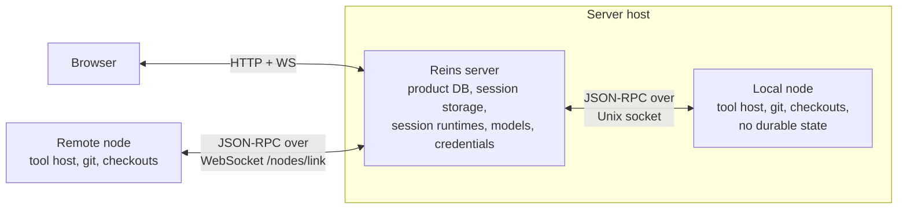

# Node Architecture

Status: **local process split done; server-canonical storage done ([ADR-015](../adr/015-server-canonical-storage-stateless-node.md)); remote nodes done: pairing and authentication ([ADR-023](../adr/023-node-pairing-and-challenge-authentication.md)), the WebSocket transport ([ADR-024](../adr/024-node-link-origin-from-the-upgrade-request.md)), server-managed sources on remote nodes ([ADR-026](../adr/026-sources-managed-on-the-server.md)), and code delivery with self-update ([ADR-025](../adr/025-node-version-handshake.md)); sessions on the server, nodes host tools, done ([ADR-029](../adr/029-sessions-on-the-server-nodes-host-tools.md)). Open: the local node on the bundle, node management, choosing a session's node and the items below.** Every session runs on the server: AgentHarness over its storage in the server's database, the server's model runtime and credentials, kept across reloads in a process-owned runtime map ([session-runtime.md](../dev/session-runtime.md)). Every node is a tool and file host: it runs the agent's file operations and commands, git and the file browser's reads on its checkouts, runs no Pi and holds nothing durable. The local node is a separate process linked over a Unix socket, run from source by the supervisor; a remote node is installed from the server with one command, runs the server's node bundle and links over a WebSocket. The completed phases are recorded in [completed/node-local-process-split.md](completed/node-local-process-split.md), [completed/server-canonical-storage.md](completed/server-canonical-storage.md), [completed/node-pairing.md](completed/node-pairing.md) and [completed/remote-nodes.md](completed/remote-nodes.md), and the move of sessions to the server in [ADR-029](../adr/029-sessions-on-the-server-nodes-host-tools.md); the current design is in [node-transport.md](../dev/node-transport.md), [node-contract.md](../dev/node-contract.md), [session-runtime.md](../dev/session-runtime.md) and [node-bundle.md](../dev/node-bundle.md).

## Motivation

Support multiple machines (e.g. a Mac and a Linux box, or disposable cloud machines), each with their own checkouts, connected to one Reins server, and eventually a hosted server with users connecting their own machines as nodes. Browser traffic, including agent events, stays routed through the server.

## Server-canonical storage (done)

The server's SQLite is the only session storage and the node holds nothing durable ([ADR-015](../adr/015-server-canonical-storage-stateless-node.md)). How it was delivered, the storage-traffic measurements behind the decision and the deferred write-behind decorator for high-latency links (not built, and moot since sessions run on the server: storage no longer crosses the link, ADR-029) are in [completed/server-canonical-storage.md](completed/server-canonical-storage.md).

## Remaining work

- [x] **Explicit node reload and automatic resume:** a CLI or an agent's `execute` script reloads the node; runs are held at clean pause points, the node restarts and the server resumes them. The server resumes every run a node lost, within a limit against crash loops; SIGTERM pauses runs instead of aborting them ([ADR-021](../adr/021-explicit-node-reload.md), [completed/node-reload.md](completed/node-reload.md)). The same path serves *Code delivery* below.
- [x] **Idle runtime eviction:** done on the server with *Sessions on the server; nodes host tools*: the process's sweep closes a runtime idle 3 minutes and not streaming, and a new app closes idle runtimes at once and running ones once idle, so the next prompt opens on the new code (session-runtime.md *What the process keeps*).
- [x] **Chunked storage calls:** a storage read result, commit or commit result longer than the link's storage chunk (`STORAGE_CHUNK_CHARS`, 1 Mi characters, or a quarter of a smaller frame cap) crosses in slices of its serialized JSON: a held reply fetched by offset (`storage.readPart`), writes uploaded slice by slice and applied with the last (`storage.commitPart`), all on one connection (protocol 9). Streams did not fit (they run node→server and are opened by the server). A resent commit is uploaded again and answered from its `commitId` record. Partial payloads are bounded per connection and freed on close. Deleted with protocol 12: storage no longer crosses the link (ADR-029).
- [x] **Reconnect-safe node calls:** a dropped link should cost only a reconnect. Remote links will drop on their own, so they need this anyway. Then make the hub reloadable. Since ADR-029 the link carries no storage, reports or session commands: what rides a drop is a session's tool calls (a file operation sent again, a command picked up again by its ID and output offset; node-contract.md *Files*, *Shell commands*), and the retry-safe commits and reports below went with the node's session path. In order:
  - [x] **Retry-safe commits:** an unanswered `storage.commit` was resent under its `commitId` on the next connection; the session row kept the last applied commit's ID and result (protocol 7, [ADR-010](../adr/010-state-derived-idempotency.md); removed with protocol 12, migration 054).
  - [x] **Retry-safe reports:** an unanswered `session.started`/`session.settled` was resent; a repeated start applies nothing and a settlement is recognised by its `reportId` (the run ID cannot tell a resend from a resumed run). The reports no longer cross the link: the server's runtimes create each settlement in-process and apply it once, so the `reportId` check went too (migration 055).
  - [x] **Reloadable hub:** a dev reload builds a new app state (`createAppState`: a new hub) and node socket listener and closes the previous ones; the node redials and in-flight work recovers through the paths above ([ADR-020](../adr/020-reloadable-node-hub.md), [hot-reload.md](../dev/hot-reload.md)). Deleted: the `restartRequired` rules and process-owned module list, the import rewriting in dev bundles, the `NodeHubServices` port and its per-call lookup (the hub calls product code directly; a connection resolves its handlers once, at hello), `DeliveryDeferred` in the protocol package (back in the dispatcher); submission failure recipients moved onto the browser client; `node-link/` folded into `nodes/`. Only process startup code warns restart-required. `execute` stays non-retryable: a reload stopping the app that runs a script fails that one tool call with "may have run" (it now runs on the server, not over the link).
- [x] **Node bundle spike:** a single-file `bun build --target bun` of `packages/node/src/main.ts` (11 MB at the time, ~150 ms to build, ~215 ms to start, deterministic) ran real sessions from a directory outside the repository with no `node_modules`. It covered AGENTS.md and skill discovery in the session cwd, slash expansion, `read`/`bash`, an image attachment, git and `fs.*` through the node, and a clean SIGTERM. The fixes it found shipped with *Code delivery* ([completed/remote-nodes.md](completed/remote-nodes.md) *Decisions*, [node-bundle.md](../dev/node-bundle.md)).
- [x] **Pairing and node authentication:** settings-page pairing codes, `reins node pair`, Ed25519 node keys, the server-first challenge (`node.authenticate`, before `node.hello`) and revocation ([ADR-023](../adr/023-node-pairing-and-challenge-authentication.md), [completed/node-pairing.md](completed/node-pairing.md), node-contract.md *Pairing and authentication*). The transport decides whether a connection authenticates (`accept(socket, {authenticate: {origin}})`); the local socket does not, so the local node needs no pairing. A revoked node is refused at hello on every transport. Every refusal (unknown, revoked or removed node, failed challenge, a hello for another node) is `NODE_REFUSED` (`-32005`): the dialer stops instead of redialing, and the supervised node exits with a code the supervisor does not restart (node-contract.md *Process model*). Tested: stolen, expired and competing codes, challenge replay, a wrong node ID in the hello, reconnect fencing, revocation, CLI re-run safety, and CLI → endpoint → challenge end to end. What it left (the install command, the WebSocket route's origin, accepting from `open`, the pairing step waiting for the first connection) shipped with *Remote transport* and *Code delivery*. Deferred: key rotation (revoke and re-pair for now), fingerprint confirmation, an audit log.
- [x] **Remote transport** ([completed/remote-nodes.md](completed/remote-nodes.md)): JSON-RPC over WebSocket at `/nodes/link` on the HTTP server (`nodes/node-link.ts`), behind the same `LinkSocket` seam, accepted from `open` so the challenge is the first frame. The process owner drives any socket whose upgrade data carries handlers with them, so node-link sockets belong to the app that upgraded them. The origin the signature is checked against comes from the upgrade request (`X-Forwarded-Proto`/`X-Forwarded-Host`, else the request; [ADR-024](../adr/024-node-link-origin-from-the-upgrade-request.md)). Frame cap 16 MiB (`REMOTE_MAX_FRAME_BYTES`) both ways. Prompt content was bounded to 8 MiB of JSON at submission and the system prompt to 1 Mi characters so an opening command would fit; since protocol 12 prompts do not cross the link ([ADR-029](../adr/029-sessions-on-the-server-nodes-host-tools.md)), the system prompt bound is gone and the content bound (`MAX_PROMPT_CONTENT_BYTES`) stays only as a sanity bound on a submission. The node dials `ws://`/`wss://` from its paired config (`webSocketTransport`; `reins node run`), sharing `connectNode` with the local link. Until the outbox went ([ADR-029](../adr/029-sessions-on-the-server-nodes-host-tools.md)), its dispatcher bounded deliveries per node so a slow node could not hold the slots of others; nothing is queued for a node now. The settings page's pairing step waits for the new node's first connection. Known gap: Bun 1.3.9's client WebSocket reports `bufferedAmount` 0, so node-side stream pacing does nothing on the remote link (node-transport.md *1b*). Process test: `remote-node.process-test.ts`.
- [x] **Bundle-safe node source fixes:** `createPiResources` passed `noExtensions: true`; the REINS docs come from `REINS_DOCS_DIR`, falling back to the checkout's `docs/`, and the developer docs are named only where `<docs>/dev` exists (a bundle ships only `features/`). Since ADR-029 the node runs no Pi, so `PI_OFFLINE` and the other Pi workarounds are gone; the node reports its docs directory (in its hello since protocol 13) and the server's runtime names it.
- [x] **Code delivery** ([ADR-025](../adr/025-node-version-handshake.md), [completed/remote-nodes.md](completed/remote-nodes.md), [node-bundle.md](../dev/node-bundle.md)): the server builds the node bundle (`reins.js`: the `reins` CLI and all of the node, with `docs/features` embedded; build ID its sha256) at each app's start and serves it with its manifest and the install script (`/nodes/*`). Settings shows the one-line install command with the pairing code; the script fetches the pinned Bun and the bundle into `~/.reins` and runs `reins node setup` (pair, declare `--source`s, start in the background, wait for the connection). `reins node start|stop|status` and the launcher's restart loop run it. The hello carries `buildId` and is answered `ready`, `update` or `error` (protocol 10); a node on another build installs the server's (and its Bun), flips `current` and restarts through its launcher (since ADR-029 this interrupts only the commands it was running). Acceptance: `node-install.process-test.ts`.
- [ ] **Local node on the bundle, and no restart for protocol changes:** the local node still runs from source under the supervisor, and a `@reins/node-protocol` edit still needs `bun run dev` restarted: dev reloads keep the protocol external so the server cannot move ahead of the node. With the `update` reply that rule can go. Bundle the protocol into every app, so the server always reloads. The hello carries a fingerprint of the node's protocol code (a hash of its sources, or the build ID). On a mismatch the server answers `update`, which for the local node means reload from the checkout through the existing `node.reload` path. A node whose new code does not build stays on its old code and is told again at each redial. With the hub per app, every reload drops the links and each node redials at once, so the hello's fingerprint check happens at once after any reload. Costs: every saved protocol edit restarts the local node, cutting off the commands it runs (runs are on the server and are not affected otherwise). Amends ADR-020 and ADR-021. Deferred (2026-10-12): protocol edits are rare now that nodes only host tools, and this trades a manual restart for about as much code as it removes. If built, treat the local node like a remote one rather than adding a separate fingerprint: it announces a build ID (a hash of its sources), and a build that differs from the server's gets `update`, meaning install the bundle on a remote node and reload from the checkout on the local one; that removes the from-source exception (no build announced, never told to update).
  - [x] The dev supervisor restarts the server process itself on process-owner edits (2026-10-12): the server exits with `SERVER_RESTART_EXIT_CODE` after suspending its runs, once its new code builds, and the supervisor starts it again alone, the node and its commands running on (hot-reload.md *Restarting the server*; `kill -HUP <server pid>` by hand). Only `supervisor.ts` and protocol edits still need `bun run dev` restarted; after a protocol edit the watcher warns instead of restarting the server alone, until that full restart. The rest of this item (the protocol bundled into the app, the fingerprint, the local node told to reload) is open. Running the local node through the `reins` launcher is optional beyond that.
- [ ] **Node install follow-ups:** running the node as a background service that survives a reboot (systemd user unit or launchd agent; today `reins node start` is a detached process); a Windows (PowerShell) install command; pruning old builds from `builds/`; removing the temporary files an interrupted install leaves in the node home; the server caching Bun for node machines without internet access; a sender for the `error` hello reply (none yet).
- [x] **Sources on remote nodes: server-managed** ([ADR-026](../adr/026-sources-managed-on-the-server.md)): the server's `sources` table is the only record of a node's checkouts, managed on the server only: the project form (create a project on a node; **Add checkout** on another node in a project's settings), `POST /api/projects/:id/sources {nodeId, path}` and `reins source add|list`. A node keeps no list and runs in the path the server sends, as the local node always has; `createSource` checks the path on the node (`fs.list` of `.`), refuses a relative path and keeps a checkout to one project and a project to one checkout per node. Settings → Nodes lists each node's checkouts read-only. This reversed the node-declared sources first built (`reins node source`, `node.json`'s `sources`, the hello's `sources`, `nodes.reported_sources`, enforcement on the node, a config watch that redialed to re-report; [completed/remote-nodes.md](completed/remote-nodes.md)): under the trust model a node-side allowlist protects nothing. Lost with it: the node suggesting its checkouts; a remote directory picker (listing directories on a node through `fs.list` from a root) could replace it later.
- [x] **Node→server streams:** `stream.data`/`stream.end`/`stream.cancel` (protocol 5), the node sender paced by socket drain and the per-connection server registry exposing each stream as a `ReadableStream` (capped in memory). See node-transport.md *Streams*. `process.run` opens them.
- [ ] **Git and file operations behind the node** ([ADR-018](../adr/018-process-run-and-fs-methods.md)): git runs through the generic `process.run` stream with the git logic staying on the server (`Git` on `nodeSpawn`); the file browser's filesystem reads are typed `fs.*` methods. **Done:** `process.run`, `fs.list`, `fs.read`, `fs.write`, binary stream chunks; uploads; file listing and file content (working tree and refs), branch and task operations, sync, spread/push/rebase, files at a ref and the diffs (the working-tree diff's temporary index built on the node by one `sh -c` script), all on the call's source (node-contract.md *Which checkout a call works in*; 503 when its node is offline). **Remaining:** which checkout the frontend's file, diff and git requests read: they use the project's default source for now, and how they pick one will be handled differently once projects support multiple sources. The server runs no git of its own: `Git` (`git.ts`) always runs on a source's node, including `createProject`'s default-branch detection (in the source the trigger creates, until project creation picks a node). Part of *Remote rollout*.
- [ ] **Background process output (later):** stream a node-side process's output over the same primitive, resuming from an offset after a reconnect. The node half is built for tool calls (ADR-029): `pi.exec` keeps a command and the tail of its output records (`EXEC_TAIL_BYTES`, 1 MiB) for `EXEC_GRACE_MS` (60 s) after its stream drops, and `pi.execAttach` picks it up by ID and offset (node-contract.md *Shell commands*). Left: commands that outlive their tool call (a grace period long enough, or none), and whether the server spills a long-lived stream to disk instead of failing it at the buffer cap.
- [x] **Remote rollout:** every server-local checkout operation (git, file listing and reading, diffs, uploads, skills) reaches its checkout through the node: `process.run` and `fs.*`, the checkout's context files and skills discovered by the server through `fs.*` (ADR-018, ADR-029; node-contract.md *Checkout operations*, *Files*). The server never accepts a browser-supplied host path and never builds a command from browser input except as separate arguments. A checkout's context files and skills come from its node, merged with that node's `~/.agents` (until 2026-10-18 the server's), at each run, so two sources of one project can differ (session-runtime.md *The environment*). Still open: pinning skill versions, and tests for two sources with different skills and relative reference reads.
- [x] **Credential lookups per runtime open:** the node cached logged-out answers and the credential list (241 `credentials.get` per runtime open before, 43 on the first open after an attach). Moot since ADR-029: credentials never leave the server, and a runtime reads them from the server's store in process.
- [ ] **Node management screen:** Settings → Nodes lists nodes with their connection status and build (**updating…**, **old build**) live, pairs with the install command and follows the new node until it connects, renames and removes nodes, and shows how many sources each holds ([settings.md](../features/settings.md) *Nodes*); sources are added from the project ([projects.md](../features/projects.md)). Removing a node abandons it, whatever it holds: its row stays (`removed_at`), it is refused at hello, no longer listed or offered and its sources are no project's default; its sessions stay readable, refuse new work ("move it to another node to continue"; tool calls waiting for it fail, a run in progress ends as interrupted) and move to a live node holding a source of the project (node-contract.md *Pairing and authentication*, Removal). Still to come: revoke on a node detail page, removing a checkout from a project (a source no session is bound to), a directory picker for a checkout's path on a remote node, and source selection for new sessions once projects have sources on several nodes (replacing the "first source" default with a per-project choice); decide whether offline nodes appear in the source picker. Known gap: renaming a project does not update the node views that name it.
- [ ] **Choosing a session's node** (found using a remote node, 2026-10-11): a project with sources on several nodes has no way to pick where a new session runs: it goes to the project's first source, and the only way elsewhere is moving it afterwards (right click). Let the new-session flow pick the source (its node), defaulting to the project's first source or the last one used; show the session's node in the chat view (the session view already carries `placement {nodeId, nodeName, available}`). Pinned: adding a source to a project (project settings → Add source) works but is rough; revisit with this. Independent of the session move below, so it can ship first; since sessions run on the server the model list does not depend on the node, so the node and model pickers are independent choices. Proposed, not yet agreed: a node chip beside the model picker in the chat header (`session-model-picker` in `chat-panel.ts`) showing the node and whether it is connected, opening the move targets (`GET /api/sessions/:id/move-targets`) while the session is idle, which on an empty session is choosing its node; the default being the source of the project's most recent session (from session rows, no new column), else the first source; offline nodes listed and marked, choosable (the work waits); a split **New session on…** button at creation as well or instead. Related: the toolbar's branch indicator, file browser and diffs read the project's default source, so a session on another node shows the wrong checkout's branch; they should follow the open session's source (*Git and file operations behind the node*, Remaining).
- [x] **Sessions on the server; nodes host tools** (decided and built 2026-10-11, [ADR-029](../adr/029-sessions-on-the-server-nodes-host-tools.md); replaced *Models on remote nodes*, found using a Mac as a remote node: a session there saw only the node's model catalog and lacked the server's custom providers and endpoints). Sessions run on the server in a process-owned runtime map kept across reloads ([session-runtime.md](../dev/session-runtime.md)); every node is a tool and file host ([node-contract.md](../dev/node-contract.md) *Tool host*). Summary and what is left to revisit in *Sessions on the server; nodes host tools* below. In order:
  - [x] ADR-029.
  - [x] Step 1: tool-host methods on nodes (`env.fs`, `env.exec`/`env.execAttach`/`env.execKill`: a remote `ExecutionEnv`, commands kept running across a dropped link and picked up again; `checkout.environment`; protocol 11) and the server's `RemoteExecutionEnv`, checked against Pi's local environment. Reshaped by protocol 13 (below).
  - [x] Step 2a: the process-owned database connection and runtime map (`process-state.ts`), the surface a runtime calls on the app (`Server` then; *Ownership* below), the session runtime in the backend (`session-runtime/`) with the environment from the server plus the checkout.
  - [x] Step 2b, the switch: submissions straight to the runtime (`Sessions.submit`, one chain per session), abort, resume and model changes on the live runtime, two-step child reports, recovery at process start with its resume budget on the session row, SIGTERM pause and suspend, `GET /api/projects/:id/skills` on the merged skills, the outbox deleted (migration 052). Then: a node reload drains its running commands, and migration 053 (assistant messages stored without a usage).
  - [x] Step 3: the node-side session path deleted (`session.*`, `storage.*`, reports, `session.event`, attachments, credentials, `script.*`, `skills.list`, their server handlers and fencing; migration 054), and Pi from the bundle (protocol 12; 12.4 MB to 0.76 MB, holding of Pi only its execution environment, `reins/node-runs-no-pi`). An older node bundle's hello is still read and answered `update`.
  - [x] Step 4: the docs (node-contract.md, session-runtime.md, node-transport.md, node-bundle.md, hot-reload.md, features). The `session-bus` telemetry, which had no feeder, deleted.
  - [x] Ownership (2026-10-12): the process and the app. What the process owns is one `ServerProcess` (database, browser `broadcast`, `OpenSessions`, the credential store's per-provider lock, the current app, frontend dir, node socket), passed whole to every app (`start(process, {recoverRuns})`); an app's state is `AppState` (`process` plus its hub, `/nodes/link`, node bundle); a runtime keeps the process only and reaches the current app's `App` (`node()`, the Reins tools, registered by each app) through `process.app`, read at each call (a property: undefined during a reload's gap, which each kind of call handles itself); attachments and credentials no longer go through the app (hot-reload.md *Ownership*).
  - [x] The node hub per app again (2026-10-12): moving the hub into the process (so a reload kept links) was tried and undone; a reload dropping links is fine, since nodes redial and a bash command in flight picks its output up again (`env.execAttach`). Kept from it: `ServerProcess.credentialLocks`, `app.ts` (`createApp`), and the process-owned sources listed once (`process-owned.json`: restart-only in the watcher, held to each other, the protocol and packages by `reins/process-owned-imports`).
  - [x] The current app is a plain property (`process.app`, undefined during a reload's gap): nothing awaits it. Node calls find no node (`unavailable`) and wait as for an offline node; Reins tool calls in the gap are not run (session-runtime.md *Reaching the current app*).
  - [x] One family of file methods; the server discovers the checkout's environment (2026-10-12, [ADR-029](../adr/029-sessions-on-the-server-nodes-host-tools.md), protocol 13): `fs.list`/`fs.read`/`fs.write` and `env.fs` became one `fs.*` family with Pi's semantics (`fs.info`, `fs.list`, `fs.read`, `fs.write`, `fs.absolutePath`, `fs.canonicalPath`), confining nothing on the node (the server confines a browser's paths); `checkout.environment` went: the server runs Pi's `loadSkills` and reads the AGENTS.md files over a strict remote environment, as it does its own `~/.agents` locally, and the node says where its docs are in its hello; `env.exec*` became `pi.exec*`. Considered and left: merging `process.run` into the shell commands (Pi's capture is bounded, merged and text; git needs all of stdout, raw).
  - [x] A runtime applies its own run lifecycle (2026-10-12): `runStarted`/`runSettled` with its own code on the process's database and broadcast, a child's report steered into the parent's runtime through the process (`submitToSession`); `process.reportRun`, its per-session queue and `App.runStarted`/`runSettled` are gone. A runtime opened by an older app's code while a newer one is current is retired at once (`APP_CODE`).
  - [x] The unused `sourceId` left the wire (2026-10-12, protocol 14): `process.run`, `fs.*` and `pi.exec` name only the path they work in (`cwd`), as the node only ever read; `RemoteNode.spawn` and `RemoteExecutionEnv` take no source. The server still resolves which source a call works in (`sessions.source_id`, `resolveSource`); a node needs no source to be called.
  - [x] Epochs and per-method capabilities left the wire (2026-10-13, protocol 15): with sessions on the server the only node→server traffic is stream frames, which belong to the socket they arrive on, so frames carry no epoch and each side only checks that the connection negotiated; both sides offer one protocol version, which fixes the methods, so the hello's `capabilities` are not read (a node still sends them empty, with `liveSessions`, for older servers) and the `ready` reply is `{kind, version}`. A hello that does not say where the node's docs are is not negotiated, so `RemoteNode.docs` is null only while the node is offline.
- [ ] **Process-test speed (optional):** fixed waits (`[slow:3000]`/`[slow:1500]` faux-provider stalls, reconnect backoff) are most of `server-process.process-test.ts`'s ~17s; a provider that blocks until the test releases it would roughly halve it.
- [ ] **Plugin-started nodes:** a plugin that starts a node for a session or task is a server-side placement decision (pick or create the source before the first command is dispatched), not a node-side provisioning step. Add it as a hook in source selection when there is a plugin to use it.
- [ ] **Compute nodes and kinds of source** (pinned 2026-10-12, not agreed): using a node purely for compute (install something, run a command), with or without a repo. Short work on any node is done (below, Scripting); longer work still runs only through a session's tools, on its own source's node. Rejected: server-held jobs for long commands (scripts time out at 30 s; the node kills an unread command after `EXEC_GRACE_MS`), and sources without a project (sessions, tasks, routing and the scripting context are all project-scoped). Direction: put a source on the node (a plain directory) and run a session there, which needs:
  - **Sessions that do not depend on git:** a source that is not a repository hides the changes tab, branch indicator and tasks and runs no git; `base_branch` nullable for such projects; the project form offers a plain directory.
  - **Several sources of a project on one node, not all the same thing:** drop the one-source-per-node rule (`createSource`), keeping `(node_id, path)` unique. Proposed: a source has a kind, a *checkout* (a copy of the project's repo, interchangeable across nodes: tasks, branches, changes, `base_branch`) or a *workspace* (any other directory, possibly another repo; no tasks or changes), and a name. A session moves only between sources of its kind; the new-session flow picks a source rather than a node (amends *Choosing a session's node*). Open: whether another repo is a third kind; whether the kind is declared (detection only suggesting it) or detected; whether a task's sessions may use a workspace.
  - **Scripting:** `nodes.list()` and `nodes.get(nodeId?)` are done (2026-10-12, scripting.md): the list gives each node's ID, name, hostname, whether it is connected, revoked or the caller's, and its source count; `get` adds its sources with their paths. Node file and command access is done (2026-10-19, scripting.md *Files and commands on any node*, node-contract.md *Shell commands*): `nodes.readFile`, `nodes.writeFile` and `nodes.run` on any connected node (by ID, name or `"current"`), any path, over the operations under the agent's tools, no protocol change; bounded to 16 MiB and to the script's 30 s, failing at once for a node not connected. Still to come: `projects.addSource(projectId, nodeId, path)` over `createSource`, and `sessions.start` in another project or source (it starts only in the caller's).

## Remote nodes: direction for open work

Remote nodes are built ([completed/remote-nodes.md](completed/remote-nodes.md)); the connection, server-managed sources, the bundle and its updates are current design in [node-transport.md](../dev/node-transport.md), [node-contract.md](../dev/node-contract.md) and [node-bundle.md](../dev/node-bundle.md), the version handshake in [ADR-025](../adr/025-node-version-handshake.md). What still directs open work:

### Trust model (decided)

- **Private network only.** Reins is exposed only on a private network (e.g. Tailscale). This is a deployment assumption, not something code checks or enforces. Anyone who can reach the server is effectively an administrator: the browser API is unauthenticated, so they can create pairing grants, change settings and run scripts. Frontend authentication is a prerequisite for any wider exposure and is out of scope here.
- **Nodes get no credentials.** Sessions run on the server ([ADR-029](../adr/029-sessions-on-the-server-nodes-host-tools.md)): credentials and model configuration never leave the server's machine. (Until then, under [ADR-013](../adr/013-server-holds-credentials.md), any authenticated node was served every provider's credentials.)
- **Nodes authenticate anyway** ([ADR-023](../adr/023-node-pairing-and-challenge-authentication.md)). Not to defend against the network: a node's stored identity can only be replaced by re-pairing that machine, and a stale or mistaken node (or a copy of the database) must not be able to pose as another node. Hence a keypair per node rather than a shared token.
- The server can already run arbitrary bash on a node through prompts, so the server delivering the node's code adds no new trust. The bundle and install script are public on the private network: code with no secrets, so downloading them grants nothing. Joining requires redeeming a pairing code; connecting requires the registered node key.

### Upgrades

An upgrade restarts the server, which pauses its runs at clean points and resumes them when it starts (session-runtime.md *Recovery*); each node redials, is told `update` and restarts on the new bundle, which cuts off only the commands it was running (their tool calls come back "outcome unknown"; ADR-025, ADR-029). **Later, if that proves costly:** the server could drain its nodes' commands before restarting for an upgrade (`node.reload`'s drain over the old protocol, bounded); and push a node-only build to connected nodes over the live link instead of waiting for a redial. The bootstrap surface ADR-025 lists changes only additively.

### Sessions on the server; nodes host tools (done)

Decided and built 2026-10-11: [ADR-029](../adr/029-sessions-on-the-server-nodes-host-tools.md) has the reasons (a model set up only on the server, and an endpoint on the server's `127.0.0.1`, could not work on a remote node), the options rejected (copying model configuration to nodes; the server as model gateway; the node's runtime in the server process over an in-memory link; a separate package), and the decision as built: running sessions in a process-owned runtime map with 3-minute idle eviction and a process-owned database connection, the outbox replaced by Pi's admission, every node a tool and file host whose commands survive a dropped link, the environment from the server's `~/.agents` plus the checkout's (since 2026-10-18, the node's `~/.agents` plus the checkout's), and no compatibility path. Current design: [session-runtime.md](../dev/session-runtime.md), [node-contract.md](../dev/node-contract.md) *Tool host*.

How a remote session reads the server's skills: resolved 2026-10-18 (ADR-029 *The environment comes from the node*): the environment comes from the node (its `~/.agents` and the checkout's); skills shared across nodes will come from Reins. Adopting pi-durable moved to [TODO.md](../TODO.md).

**Later:**

- A package or process of its own for the session code (not a node), supervised beside the server, if keeping runtimes on old code across reloads proves costly.
- A model only one node can reach (none today): a node could offer an endpoint back through the server.

## Cloud nodes (future)

Disposable cloud machines (e.g. Fly Sprites, which resume from checkpoint in about a second) are natural nodes, and a stateless node suits them: there is nothing on the machine to back up or re-hydrate. Reins would manage only a sleep/wake lifecycle: track nodes as online, sleeping or offline; on a prompt for a sleeping wakeable node, trigger a wake (a run already waits for its node at its first request, and its tool calls wait for it); show "Starting…" for a waking cloud node and "Offline" for an unreachable personal machine. Provisioning the machine (tools, clones, CLI auth) stays outside Reins.

## Open questions

- **Where inference runs:** decided 2026-10-11: on the server side, with nodes as tool hosts (*Sessions on the server; nodes host tools*).
- **Frontend authentication:** not needed while Reins is exposed only on a private network (see *Trust model*); required before any wider exposure. Account authentication and user-scoped authorization are separate from node identity; passkeys are a candidate.
- **Privacy and trust:** a node lets the server route prompts that execute on the user's machine, and the server receives all events and transcripts. Fine for self-hosting; for a hosted multi-user service, explore node-side tool permissions and approval gates, audit logging of server-initiated commands, scoped node permissions and end-to-end encrypted storage. Self-hosted remains the primary model.
- **Latency:** every tool call on a remote node is a round trip from the server (a file operation, a command and its streamed output); events no longer cross the link. Batching a tool's file operations, or a larger remote environment (pi-durable's), is a possible later optimization.
- **Multiple sources per project:** the model allows it; decide the default-source policy and UX once it is real.
- **Protocol standards:** whether ACP could carry the server–node command/event channel (see [ADR-006](../adr/006-acpx-as-runtime-replacement.md) for the runtime-level evaluation).
