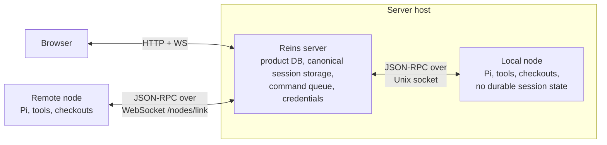

# Node Architecture

Status: **local process split done; server-canonical storage done ([ADR-015](../adr/015-server-canonical-storage-stateless-node.md)); remote nodes done: pairing and authentication ([ADR-023](../adr/023-node-pairing-and-challenge-authentication.md)), the WebSocket transport ([ADR-024](../adr/024-node-link-origin-from-the-upgrade-request.md)), server-managed sources on remote nodes ([ADR-026](../adr/026-sources-managed-on-the-server.md)), and code delivery with self-update ([ADR-025](../adr/025-node-version-handshake.md)). Open: moving running sessions to the server with nodes as tool hosts (decided 2026-10-11, *Sessions on the server; nodes host tools*), the local node on the bundle, node management, idle eviction and the items below.** Today every session runs on a node; the server stores every session, dispatches work through a durable queue and serves the UI. The node holds nothing durable: its Pi runtime reads and commits each session on the server over the link. The local node is a separate process linked over a Unix socket, run from source by the supervisor; a remote node is installed from the server with one command, runs the server's node bundle and links over a WebSocket. The completed phases are recorded in [completed/node-local-process-split.md](completed/node-local-process-split.md), [completed/server-canonical-storage.md](completed/server-canonical-storage.md), [completed/node-pairing.md](completed/node-pairing.md) and [completed/remote-nodes.md](completed/remote-nodes.md); the current design is in [node-transport.md](../dev/node-transport.md), [node-contract.md](../dev/node-contract.md), [node-runtime.md](../dev/node-runtime.md) and [node-bundle.md](../dev/node-bundle.md).

## Motivation

Support multiple machines (e.g. a Mac and a Linux box, or disposable cloud machines), each with their own checkouts, connected to one Reins server, and eventually a hosted server with users connecting their own machines as nodes. Browser traffic, including agent events, stays routed through the server.

## Server-canonical storage (done)

The server's SQLite is the only session storage and the node holds nothing durable ([ADR-015](../adr/015-server-canonical-storage-stateless-node.md)). How it was delivered, the storage-traffic measurements behind the decision and the deferred write-behind decorator for high-latency links (not built: build it only after measuring a real remote node) are in [completed/server-canonical-storage.md](completed/server-canonical-storage.md).

## Remaining work

- [x] **Explicit node reload and automatic resume:** a CLI or an agent's `execute` script reloads the node; runs are held at clean pause points, the node restarts and the server resumes them. The server resumes every run a node lost, within a limit against crash loops; SIGTERM pauses runs instead of aborting them ([ADR-021](../adr/021-explicit-node-reload.md), [completed/node-reload.md](completed/node-reload.md)). The same path serves *Code delivery* below.
- [ ] **Idle runtime eviction:** close runtimes idle for a fixed period (they hold nothing durable), which also bounds node memory and picks up new node code between turns. Once sessions run on the server (*Sessions on the server; nodes host tools*) this applies to the server's session layer instead.
- [x] **Chunked storage calls:** a storage read result, commit or commit result longer than the link's storage chunk (`STORAGE_CHUNK_CHARS`, 1 Mi characters, or a quarter of a smaller frame cap) crosses in slices of its serialized JSON: a held reply fetched by offset (`storage.readPart`), writes uploaded slice by slice and applied with the last (`storage.commitPart`), all on one connection (protocol 9). Streams did not fit (they run node→server and are opened by the server). A resent commit is uploaded again and answered from its `commitId` record. Partial payloads are bounded per connection and freed on close (node-contract.md *Session storage*). Left: fencing and the commit record are checked only at a long commit's last slice.
- [ ] **Reconnect-safe node calls:** a dropped link should cost only a reconnect. Remote links will drop on their own, so they need this anyway. Then make the hub reloadable. In order:
  - [x] **Retry-safe commits:** an unanswered `storage.commit` is resent under its `commitId` on the next connection; the session row keeps the last applied commit's ID and result, and a repeat is answered with it (protocol 7; node-contract.md *Session storage*, [ADR-010](../adr/010-state-derived-idempotency.md)).
  - [x] **Retry-safe reports:** an unanswered `session.started`/`session.settled` is resent; a repeated start applies nothing and a settlement is recognised by its `reportId` (the run ID cannot tell a resend from a resumed run). A session with a report still to deliver is listed live in the hello, so crash recovery leaves it alone.
  - [x] **Reloadable hub:** a dev handler reload builds a new state (`createServerState`: a new hub) and node socket listener and closes the previous ones; the node redials and in-flight work recovers through the paths above ([ADR-020](../adr/020-reloadable-node-hub.md), [hot-reload.md](../dev/hot-reload.md)). Deleted: the `restartRequired` rules and process-owned module list, the import rewriting in dev bundles, the `NodeHubServices` port and its per-call lookup (the hub calls product code directly; a connection resolves its handlers once, at hello), `DeliveryDeferred` in the protocol package (back in the dispatcher); submission failure recipients moved onto the browser client; `node-link/` folded into `nodes/`. Only process startup code warns restart-required. `script.execute` stays non-retryable: a drop still fails that one tool call with "may have run". A `storage.read` in flight at a drop still fails its run (reads are not resent).
- [x] **Node bundle spike:** a single-file `bun build --target bun` of `packages/node/src/main.ts` (11 MB at the time, ~150 ms to build, ~215 ms to start, deterministic) ran real sessions from a directory outside the repository with no `node_modules`. It covered AGENTS.md and skill discovery in the session cwd, slash expansion, `read`/`bash`, an image attachment, git and `fs.*` through the node, and a clean SIGTERM. The fixes it found shipped with *Code delivery* ([completed/remote-nodes.md](completed/remote-nodes.md) *Decisions*, [node-bundle.md](../dev/node-bundle.md)).
- [x] **Pairing and node authentication:** settings-page pairing codes, `reins node pair`, Ed25519 node keys, the server-first challenge (`node.authenticate`, before `node.hello`) and revocation ([ADR-023](../adr/023-node-pairing-and-challenge-authentication.md), [completed/node-pairing.md](completed/node-pairing.md), node-contract.md *Pairing and authentication*). The transport decides whether a connection authenticates (`accept(socket, {authenticate: {origin}})`); the local socket does not, so the local node needs no pairing. A revoked node is refused at hello on every transport. Every refusal (unknown, revoked or removed node, failed challenge, a hello for another node) is `NODE_REFUSED` (`-32005`): the dialer stops instead of redialing, and the supervised node exits with a code the supervisor does not restart (node-contract.md *Process model*). Tested: stolen, expired and competing codes, challenge replay, a wrong node ID in the hello, reconnect fencing, revocation, CLI re-run safety, and CLI → endpoint → challenge end to end. What it left (the install command, the WebSocket route's origin, accepting from `open`, the pairing step waiting for the first connection) shipped with *Remote transport* and *Code delivery*. Deferred: key rotation (revoke and re-pair for now), fingerprint confirmation, an audit log.
- [x] **Remote transport** ([completed/remote-nodes.md](completed/remote-nodes.md)): JSON-RPC over WebSocket at `/nodes/link` on the HTTP server (`nodes/node-link.ts`), behind the same `LinkSocket` seam, accepted from `open` so the challenge is the first frame. The process owner drives any socket whose upgrade data carries handlers with them, so node-link sockets belong to the handler load that upgraded them. The origin the signature is checked against comes from the upgrade request (`X-Forwarded-Proto`/`X-Forwarded-Host`, else the request; [ADR-024](../adr/024-node-link-origin-from-the-upgrade-request.md)). Frame cap 16 MiB (`REMOTE_MAX_FRAME_BYTES`) both ways; prompt content is bounded to 8 MiB of JSON at submission and the system prompt to 1 Mi characters, so an opening command fits. The node dials `ws://`/`wss://` from its paired config (`webSocketTransport`; `reins node run`), sharing `connectNode` with the local link. The dispatcher bounds deliveries per node (`MAX_SESSIONS_PER_NODE`), so a slow node cannot hold the slots of others. The settings page's pairing step waits for the new node's first connection. Known gap: Bun 1.3.9's client WebSocket reports `bufferedAmount` 0, so node-side stream pacing does nothing on the remote link (node-transport.md *1b*). Process test: `remote-node.process-test.ts`.
- [x] **Bundle-safe node source fixes:** `createPiResources` passes `noExtensions: true` (Pi extensions were loaded on every open, never used, and fail in a bundle); the environment prompt's REINS docs come from `REINS_DOCS_DIR`, falling back to the checkout's `docs/`, and name the developer docs only where `<docs>/dev` exists (a bundle ships only `features/`). Pi still resolves packages listed in its `settings.json` on every open and may fetch a missing one: the bundle's entry sets `PI_OFFLINE=1` (node-bundle.md *Running it*).
- [x] **Code delivery** ([ADR-025](../adr/025-node-version-handshake.md), [completed/remote-nodes.md](completed/remote-nodes.md), [node-bundle.md](../dev/node-bundle.md)): the server builds the node bundle (`reins.js`: the `reins` CLI and all of the node, with `docs/features` embedded; build ID its sha256) at each handler load and serves it with its manifest and the install script (`/nodes/*`). Settings shows the one-line install command with the pairing code; the script fetches the pinned Bun and the bundle into `~/.reins` and runs `reins node setup` (pair, declare `--source`s, start in the background, wait for the connection). `reins node start|stop|status` and the launcher's restart loop run it. The hello carries `buildId` and is answered `ready`, `update` or `error` (protocol 10); a node on another build installs the server's (and its Bun), flips `current` and restarts through its launcher, and the server resumes its runs (ADR-021). Acceptance: `node-install.process-test.ts`.
- [ ] **Local node on the bundle, and no restart for protocol changes:** the local node still runs from source under the supervisor, and a `@reins/node-protocol` edit still needs `bun run dev` restarted: dev reloads keep the protocol external so the server cannot move ahead of the node. With the `update` reply that rule can go. Bundle the protocol into every handler load, so the server always reloads. The hello carries a fingerprint of the node's protocol code (a hash of its sources, or the build ID). On a mismatch the server answers `update`, which for the local node means reload from the checkout through the existing `node.reload` path. A node whose new code does not build stays on its old code and is told again at each redial. Costs: every saved protocol edit restarts the local node, and its runs are cut off (and resumed) rather than paused at clean points, because the node cannot commit to the new server before it restarts. Have the dev supervisor restart the server process itself on process-owner edits, so only `supervisor.ts` edits still need a manual restart. Amends ADR-020 and ADR-021. Running the local node through the `reins` launcher is optional beyond that.
- [ ] **Node install follow-ups:** running the node as a background service that survives a reboot (systemd user unit or launchd agent; today `reins node start` is a detached process); a Windows (PowerShell) install command; pruning old builds from `builds/`; removing the temporary files an interrupted install leaves in the node home; the server caching Bun for node machines without internet access; a sender for the `error` hello reply (none yet).
- [x] **Sources on remote nodes: server-managed** ([ADR-026](../adr/026-sources-managed-on-the-server.md)): the server's `sources` table is the only record of a node's checkouts, managed on the server only: the project form (create a project on a node; **Add checkout** on another node in a project's settings), `POST /api/projects/:id/sources {nodeId, path}` and `reins source add|list`. A node keeps no list and runs in the path the server sends, as the local node always has; `createSource` checks the path on the node (`fs.list` of `.`), refuses a relative path and keeps a checkout to one project and a project to one checkout per node. Settings → Nodes lists each node's checkouts read-only. This reversed the node-declared sources first built (`reins node source`, `node.json`'s `sources`, the hello's `sources`, `nodes.reported_sources`, enforcement on the node, a config watch that redialed to re-report; [completed/remote-nodes.md](completed/remote-nodes.md)): under the trust model a node-side allowlist protects nothing. Lost with it: the node suggesting its checkouts; a remote directory picker (listing directories on a node through `fs.list` from a root) could replace it later.
- [x] **Node→server streams:** `stream.data`/`stream.end`/`stream.cancel` (protocol 5), the node sender paced by socket drain and the per-connection server registry exposing each stream as a `ReadableStream` (capped in memory). See node-transport.md *Streams*. `process.run` opens them.
- [ ] **Git and file operations behind the node** ([ADR-018](../adr/018-process-run-and-fs-methods.md)): git runs through the generic `process.run` stream with the git logic staying on the server (`Git` on `RemoteNode.spawn`); the file browser's filesystem reads are typed `fs.*` methods. **Done:** `process.run`, `fs.list`, `fs.read`, `fs.write`, binary stream chunks; uploads; file listing and file content (working tree and refs), branch and task operations, sync, spread/push/rebase, files at a ref and the diffs (the working-tree diff's temporary index built on the node by one `sh -c` script), all on the call's source (node-contract.md *Which checkout a call works in*; 503 when its node is offline). **Remaining:** which checkout the frontend's file, diff and git requests read: they use the project's default source for now, and how they pick one will be handled differently once projects support multiple sources. The server runs no git of its own: `Git` (`git.ts`) always runs on a source's node, including `createProject`'s default-branch detection (in the source the trigger creates, until project creation picks a node). Part of *Remote rollout*.
- [ ] **Background process output (later):** stream a node-side process's output over the same primitive, resuming from an offset after a reconnect (the node keeps the output; offsets are already absolute). Decide whether the server spills a long-lived stream to disk instead of failing it at the buffer cap. The node half (a process and its output kept across a dropped link, picked up again by ID and offset) is built with *Sessions on the server; nodes host tools*, for tool calls.
- [x] **Remote rollout:** every server-local checkout operation (git, file listing and reading, diffs, uploads, skills) reaches its checkout through the node: `process.run`, `fs.*`, `skills.list` (ADR-018; node-contract.md *Checkout operations*, *Skills*). The server never accepts a browser-supplied host path and never builds a command from browser input except as separate arguments. Skills and resources are node-local: discovered in the bound cwd at every open, so two sources of one project can differ. Still open: pinning skill versions, and tests for two sources with different skills, invocation on a server without the repo, and relative reference reads.
- [x] **Credential lookups per runtime open:** the node caches logged-out answers and the credential list until the next attach or a `credentials.changed` for the provider (node-contract.md *Credentials*). Measured per runtime open: 241 `credentials.get` before; 43 (one per provider) on the first open after an attach and none on later opens. Every server-side credential write except a routine OAuth refresh must send `credentials.changed`. Narrowing which providers Pi checks (`refreshOnCreate: false`) was not done: it empties Pi's model snapshot.
- [ ] **Node management screen:** Settings → Nodes lists nodes with their connection status and build (**updating…**, **old build**) live, pairs with the install command and follows the new node until it connects, renames and removes nodes, and shows how many sources each holds ([settings.md](../features/settings.md) *Nodes*); sources are added from the project ([projects.md](../features/projects.md)). Removing a node abandons it, whatever it holds: its row stays (`removed_at`), it is refused at hello, no longer listed or offered and its sources are no project's default; its sessions stay readable, refuse new work ("move it to another node to continue"; queued work fails, a run in progress ends as interrupted) and move to a live node holding a source of the project (node-contract.md *Pairing and authentication*, Removal). Still to come: revoke on a node detail page, removing a checkout from a project (a source no session is bound to), a directory picker for a checkout's path on a remote node, and source selection for new sessions once projects have sources on several nodes (replacing the "first source" default with a per-project choice); decide whether offline nodes appear in the source picker. Known gap: renaming a project does not update the node views that name it.
- [ ] **Choosing a session's node** (found using a remote node, 2026-10-11): a project with sources on several nodes has no way to pick where a new session runs: it goes to the project's first source, and the only way elsewhere is moving it afterwards (right click). Let the new-session flow pick the source (its node), defaulting to the project's first source or the last one used; show the session's node in the chat view (the session view already carries `placement {nodeId, nodeName, available}`). Pinned: adding a source to a project (project settings → Add source) works but is rough; revisit with this. Independent of the session move below, so it can ship first; once sessions run on the server the model list no longer depends on the node, so the node and model pickers are independent choices. Proposed, not yet agreed: a node chip beside the model picker in the chat header (`session-model-picker` in `chat-panel.ts`) showing the node and whether it is connected, opening the move targets (`GET /api/sessions/:id/move-targets`) while the session is idle, which on an empty session is choosing its node; the default being the source of the project's most recent session (from session rows, no new column), else the first source; offline nodes listed and marked, choosable (the work waits); a split **New session on…** button at creation as well or instead. Related: the toolbar's branch indicator, file browser and diffs read the project's default source, so a session on another node shows the wrong checkout's branch; they should follow the open session's source (*Git and file operations behind the node*, Remaining).
- [ ] **Sessions on the server; nodes host tools** (decided 2026-10-11; replaces *Models on remote nodes*, found using a Mac as a remote node: a session there sees only the node's model catalog and lacks the server's custom providers and endpoints). Design, reasons and the switchover in *Sessions on the server; nodes host tools* below; the decision as built is [ADR-029](../adr/029-sessions-on-the-server-nodes-host-tools.md), which departs from the section below: the outbox goes (Pi's admission is the record of submitted work), running sessions are a process-owned runtime map with 3-minute idle eviction and the code stays in the backend (hot reloaded; no separate package), the database connection is process-owned, and there is no gradual switchover (only the local node must keep working). In order:
  - [x] ADR-029.
  - [x] Tool-host methods on nodes (a remote `ExecutionEnv`: file operations, `exec` kept running across a dropped link and picked up again, the checkout's environment) and the server's side of tool calls, checked against the node-side tools.
  - [x] 2a: the process-owned database and runtime map (`process-state.ts`), the load surface a runtime calls (`LoadServices`), the session runtime copied into the backend (`session-runtime/`) with the environment from the server plus the checkout, built and tested but not yet routed to (hot-reload.md *Sessions on the server*). The node's hello recovery leaves sessions with a live server runtime alone.
  - [x] 2b, the switch: submissions straight to the runtime (`Sessions.submit` with one chain per session, ws.ts, abort/resume, model changes), two-step child reports, recovery at process start (its resume budget on the session row, so a restart does not reset it), SIGTERM pause and suspend of the process's runs, `GET /api/projects/:id/skills` on the merged skills, the outbox deleted (migration 052; node-contract.md *Submitted work*). Still to try on a second instance.
  - [x] Delete the node-side session path (`session.*`, `storage.*`, reports, `session.event`, attachments, credentials, `script.*`, `skills.list` and their server handlers), its protocol methods and Pi from the bundle (protocol 12; the bundle from 12.4 MB to 0.76 MB, holding of Pi only its execution environment, `reins/node-runs-no-pi`). An older node bundle's hello (its `liveSessions`, its session capabilities) is still read and answered `update`; a node still sends `liveSessions: []` for older servers. Left: `session-bus` telemetry has no feeder (client-telemetry.md).
  - [ ] Rewrite node-contract.md, node-runtime.md, node-transport.md, node-bundle.md, hot-reload.md and features/nodes.md.
- [ ] **Process-test speed (optional):** fixed waits (`[slow:3000]`/`[slow:1500]` faux-provider stalls, reconnect backoff) are most of `server-process.process-test.ts`'s ~17s; a provider that blocks until the test releases it would roughly halve it.
- [ ] **Plugin-started nodes:** a plugin that starts a node for a session or task is a server-side placement decision (pick or create the source before the first command is dispatched), not a node-side provisioning step. Add it as a hook in source selection when there is a plugin to use it.

## Remote nodes: direction for open work

Remote nodes are built ([completed/remote-nodes.md](completed/remote-nodes.md)); the connection, server-managed sources, the bundle and its updates are current design in [node-transport.md](../dev/node-transport.md), [node-contract.md](../dev/node-contract.md) and [node-bundle.md](../dev/node-bundle.md), the version handshake in [ADR-025](../adr/025-node-version-handshake.md). What still directs open work:

### Trust model (decided)

- **Private network only.** Reins is exposed only on a private network (e.g. Tailscale). This is a deployment assumption, not something code checks or enforces. Anyone who can reach the server is effectively an administrator: the browser API is unauthenticated, so they can create pairing grants, change settings and run scripts. Frontend authentication is a prerequisite for any wider exposure and is out of scope here.
- **Nodes get every credential.** [ADR-013](../adr/013-server-holds-credentials.md) stands as is: any authenticated node is served `credentials.*` for every provider. No per-node scoping. Once sessions run on the server (below), nodes get no credentials at all.
- **Nodes authenticate anyway** ([ADR-023](../adr/023-node-pairing-and-challenge-authentication.md)). Not to defend against the network: a node's stored identity can only be replaced by re-pairing that machine, and a stale or mistaken node (or a copy of the database) must not be able to pose as another node. Hence a keypair per node rather than a shared token.
- The server can already run arbitrary bash on a node through prompts, so the server delivering the node's code adds no new trust. The bundle and install script are public on the private network: code with no secrets, so downloading them grants nothing. Joining requires redeeming a pairing code; connecting requires the registered node key.

### Upgrades

An upgrade cuts off what was in flight on a remote node: the server restarts on a new build, the node redials, is told `update`, restarts on the new bundle, and the server resumes the runs it lost (a model request is asked again, a tool call comes back "outcome unknown"; ADR-025). **Later, if that proves costly:** the server could drain its nodes before restarting for an upgrade (`Node.pause` over the old protocol, bounded, then restart), so runs wait at clean points instead; and push a node-only build to connected nodes over the live link instead of waiting for a redial. The bootstrap surface ADR-025 lists changes only additively.

### Sessions on the server; nodes host tools (decided 2026-10-11)

**Why.** Opus 5.5 did not work on a Mac paired as a remote node. Two failures, both hidden on the server's machine because the server and the local node read the same `~/.pi/agent`:

- *The catalog.* Pi 0.85.1's built-in catalog stops at `claude-opus-5`. `claude-opus-5-5` is only in the server's `~/.pi/agent/models-store.json`, which `GET /api/models` refreshes from the network (`allowModelNetwork: true`, `pi/model-catalog.ts`). The node never refreshes it: `buildNodeRuntime` does not allow model network, and the bundle sets `PI_OFFLINE=1`, which turns Pi's model network off. So the node refuses a model the picker offered (`Model not found`).
- *The endpoint.* The server's `~/.pi/agent/models.json` points `anthropic` at a local proxy (`127.0.0.1:3456`, Meridian) with its key in that file. That is provider configuration, not a credential, so the ADR-013 path never sends it, and `127.0.0.1` on the Mac is the Mac.

Custom models will keep being set up on the server, and every node should be able to use them. Options considered:

1. *Loop and inference on the node* (until now): copy `models.json` and the model store to every node and rewrite endpoints a node cannot reach. Rejected: an uphill battle with every new custom model.
2. *The server as model gateway; loop and tools on the node.* An HTTP proxy that adds credentials does not work for OAuth logins, because Pi builds the request from the credential (an `sk-ant-oat` token switches on the Claude Code system prompt, tool renames and beta headers in pi-ai's `anthropic-messages.js`; Codex and Copilot also build requests from their token). Cutting at Pi's `Models` interface instead (the harness calls only `getModel`, `streamSimple`, `completeSimple`, `streamDeferred` and `cancelDeferred`; relay them to the server's `ModelRuntime`) works, but each turn would read the context from the server's storage and upload it straight back to the server's gateway, and the server is in the path of every call anyway. Rejected.
3. *The loop on the server side; nodes host tools.* Chosen.

Pi points the same way. Pi 1.x removed AgentHarness (`@earendil-works/pi-agent-core` 1.1.0 has only `agent`, `agent-loop` and `proxy`) for `@earendil-works/pi-durable`: one process owns a storage ("no cross-process locking"), and tools touch files and processes only through a per-call `ExecutionEnv` built for remote hosts (`FileSystem.id` per container or remote host, `ShellExecOptions.window` so remote environments need not transfer output the caller drops, `registerEnvConformance`). pi-durable is experimental (its README: the API changes without notice; 1.0.3 and 1.1.0 broke it) and its `read` tool does not read images yet, so Reins stays on AgentHarness 0.85 for now. Running the loop on the server with tools behind an `ExecutionEnv` adopts pi-durable's shape, so the later switch happens in the session layer and nodes do not change.

**Decision.**

- **Running sessions live on the server side:** AgentHarness, its storage on the server's database (`PiStorageAdapter`, `pi-storage.ts`) and the server's model runtime (`pi/factory.ts`: its catalog, `models.json`, model store and credentials). Credentials and model configuration never leave the server's machine.
- **Kept across handler reloads**, as Reins kept running sessions before the node split: in state the server process owns, not in a separate process for now. Edits to that layer need a `bun run dev` restart. It is not a node: it holds no source and has no `nodes` row.
- **Every node is a tool and file host**, the server machine's included, none special. It serves the operations of Pi's tools (a remote `ExecutionEnv`) and, as now, `process.run`/`fs.*` for git and the UI. No Pi, session storage, credentials, events or lifecycle reports on nodes. The server machine's node still links over the Unix socket without pairing.
- **Skills and context** come from the server's `~/.agents` (user skills, `~/.agents/AGENTS.md`) plus the checkout's (`.agents/skills`, AGENTS.md in the checkout and its ancestors), read from the source's node. A node's own `~/.agents` is no longer seen.
- **Node links stay per handler load** (ADR-020). A tool call in flight survives a dropped link instead (below), which also covers remote links that drop on their own (a Mac sleeping, Wi-Fi).

**What it needs** (code pointers as of 2026-10-11):

- *The session layer.* Today the node's runtime drives sessions (`packages/node/src/runtime/`: `buildNodeRuntime` in `build.ts`, `pi-runtime.ts`, the pause gate, tool images, the Reins tools); it moves to the server side. Two ways to build it, to decide in the task: **(a)** run the node's session runtime in the server process, attached to each handler load's hub through an in-memory link (the shape of `@reins/node-protocol/testing`'s loopback pair), so a reload looks like today's redial and the existing resend paths (a commit's `commitId`, a report's `reportId`, outbox replay) carry runs across it; storage still goes through `storage.*`, in memory. **(b)** A process-owned layer calling product code through a narrow interface, with storage direct; it then needs a database connection across reloads, since each handler load opens and closes its own (ADR-020). (a) looks like the smaller change. Either way the import boundaries change (`reins/node-import-boundary` forbids backend production code importing `@reins/node`; node-contract.md *Packages and import boundaries*) and the process-owned modules become restart-only (hot-reload.md). Outbox commands for a moved session are delivered to the session layer, not a node.
- *A remote `ExecutionEnv`.* Pi's four tools touch the machine only through `ExecutionEnv` (`createHostTools` in `runtime/tools.ts` builds a `NodeExecutionEnv`). Together they use `readTextFile`, `readBinaryFile`, `writeFile`, `exec`, `fileInfo`, `exists`, `absolutePath` and `canonicalPath`, plus `cleanup`. Serve them as node methods on the session's source (its binding's `cwd`). bash's environment (`PI_SESSION_ID`, `PI_PROVIDER`, `PI_MODEL`, `PI_REASONING_LEVEL`) goes with each `exec`; its output streams back as `process.run`'s does. `read`'s images arrive as bytes and become attachments on the server. pi-durable's environment is larger (`openBinaryReader`, `openDirReader`, `watch`, argv `exec`); nodes update themselves, so adding methods later is cheap.
- *Tool calls survive a dropped link.* Every reload drops every node link, so without this a save would cut every tool call in flight on every node, the server machine's included. Short calls wait for the node to reconnect (as node calls wait today, `RECONNECT_WAIT_MS`) and are sent again: they are safe to repeat. An `exec` has an ID: the node keeps the process and the tail of its output across the drop for a grace period (e.g. 60 s, then kills it), and the remote environment picks it up again on the new link by ID and output offset and keeps piping its output into the same tool call. The model sees nothing. A node that restarted does not know the ID: "outcome unknown", as today. Keep it simple; details when built.
- *The environment from the server plus the checkout.* `ReinsResourceLoader` (`resources/loader.ts`) and slash expansion (`expandLocalPrompt`, `resources/prompt.ts`) read the filesystem directly. The checkout's part (context files and skills, with content) should come from its node in one call and be merged with the server's `~/.agents`. `skills.list` goes; `GET /api/projects/:id/skills` merges the same way. The REINS docs path in the environment prompt must be the node's (the model reads it with `read`, which runs there): the node reports its docs directory (`REINS_DOCS_DIR`; a bundle ships `docs/features`). The task branch checkout moves to the server's `Git` over `process.run` (today node-local git in `buildNodeRuntime`).
- *Direct calls instead of link calls.* Lifecycle reports (`runStarted`/`runSettled`, `sessions/session-runs.ts`), events (the browser broadcast, `sessionEventFrame`), attachments and the Reins tools (`script.execute`, `script.search`, `project.createTask`) no longer cross a node link. Fencing (`nodeOwnsSession`) changes: nodes make no session calls; the server calls a node for a session's source.
- *Removed from nodes* once every node is a tool host: `session.*` commands, `RemoteStorage` and `storage.*` over node links (slicing included), `credentials.*` and `RemoteCredentialStore`, `session.event`, attachment fetch and store, lifecycle reports, `skills.list`, and Pi in the bundle with its workarounds (`PI_OFFLINE`, `PI_PACKAGE_DIR`, `registerBundledPiModules`).
- *The ADR* amends ADR-013 (nodes get no credentials), ADR-015 (storage stops crossing to nodes), ADR-019 (the environment is no longer all machine-local) and ADR-020/021 (running sessions are kept across reloads; what pauses and resumes them).

**Switching over without breaking sessions.** Session state is all on the server already (ADR-015), and both sides run Pi 0.85.1 over the same storage, so no data migrates: only where a session is driven changes. Do not upgrade Pi in the same change.

- Transcripts, lanes and model selections are read as they are. Queued prompts stay in the outbox and go to the session layer instead of a node.
- Runs in flight at the switch are lost runs, as at any node restart: Pi left them pending and the server resumes them (ADR-021), now on its side. A model request in flight is asked again; a tool call in flight comes back "outcome unknown".
- The system prompt and skills are rebuilt at every runtime open, so a session gets the new environment at its next open (one prompt-cache miss).
- Gradually, by capability: a node on the new build advertises the tool-host methods in its hello; sessions on such a node run on the server, sessions on other nodes on the node as today. Nodes update themselves on connect, and the update restarts them, closing their runtimes; the server resumes those runs on its side, so a session is never driven in two places. Delete the node-side path once every node has moved. The hello's capability list is capped at 16 (`negotiation.ts`) and a node already advertises 14 (`CAPABILITIES` in `node-connection.ts`): raise the cap, or advertise one tool-host capability, before a node lists both sets.
- Reins is developed with Reins: try the build on a second dev instance against a copy of the database (`REINS_DATA_DIR`) before switching the main one, and back up `reins.db`. The previous build reads the same data, so going back is possible.

**Later:**

- Split the session layer into its own process, supervised beside the server (not a node), reloadable with pause and resume as the node is now, if keeping it across reloads proves costly.
- pi-durable once it is stable: in the session layer only; storage moves into its process.
- A model only one node can reach (none today): a node could offer an endpoint back through the server.

## Cloud nodes (future)

Disposable cloud machines (e.g. Fly Sprites, which resume from checkpoint in about a second) are natural nodes, and a stateless node suits them: there is nothing on the machine to back up or re-hydrate. Reins would manage only a sleep/wake lifecycle: track nodes as online, sleeping or offline; on a prompt for a sleeping wakeable node, trigger a wake and let the queued command deliver on reconnect (the command queue already holds work for disconnected nodes); show "Starting…" for a waking cloud node and "Offline" for an unreachable personal machine. Provisioning the machine (tools, clones, CLI auth) stays outside Reins. A distant cloud node is the case most likely to want the deferred write-behind decorator.

## Open questions

- **Where inference runs:** decided 2026-10-11: on the server side, with nodes as tool hosts (*Sessions on the server; nodes host tools*).
- **The server's skills on a remote node** (revisit; ADR-029 *Later*): sessions list the server's `~/.agents` skills by their server paths, and `read` runs on the node, so for now the server serves `read` itself for paths under its own `~/.agents`. Decide on something less special-cased (skill content sent with the environment, or a virtual path).
- **Frontend authentication:** not needed while Reins is exposed only on a private network (see *Trust model*); required before any wider exposure. Account authentication and user-scoped authorization are separate from node identity; passkeys are a candidate.
- **Privacy and trust:** a node lets the server route prompts that execute on the user's machine, and the server receives all events and transcripts. Fine for self-hosting; for a hosted multi-user service, explore node-side tool permissions and approval gates, audit logging of server-initiated commands, scoped node permissions and end-to-end encrypted storage. Self-hosted remains the primary model.
- **Latency:** server-relayed events add a hop for remote nodes. Direct browser–node streaming (e.g. WebRTC data channels with the server as signaling) is a possible later optimization with fallback to the relay.
- **Multiple sources per project:** the model allows it; decide the default-source policy and UX once it is real.
- **Protocol standards:** whether ACP could carry the server–node command/event channel (see [ADR-006](../adr/006-acpx-as-runtime-replacement.md) for the runtime-level evaluation).
