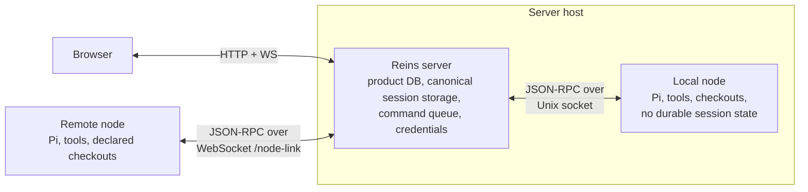

# Node Architecture

Status: **local process split done; server-canonical storage done ([ADR-015](../adr/015-server-canonical-storage-stateless-node.md)); remote nodes done: pairing and authentication ([ADR-023](../adr/023-node-pairing-and-challenge-authentication.md)), the WebSocket transport ([ADR-024](../adr/024-node-link-origin-from-the-upgrade-request.md)), node-owned sources, and code delivery with self-update ([ADR-025](../adr/025-node-version-handshake.md)). Open: the local node on the bundle, node management, idle eviction and the items below.** Every session runs on a node; the server stores every session, dispatches work through a durable queue and serves the UI. The node holds nothing durable: its Pi runtime reads and commits each session on the server over the link. The local node is a separate process linked over a Unix socket, run from source by the supervisor; a remote node is installed from the server with one command, runs the server's node bundle and links over a WebSocket. The completed phases are recorded in [completed/node-local-process-split.md](completed/node-local-process-split.md), [completed/server-canonical-storage.md](completed/server-canonical-storage.md), [completed/node-pairing.md](completed/node-pairing.md) and [completed/remote-nodes.md](completed/remote-nodes.md); the current design is in [node-transport.md](../dev/node-transport.md), [node-contract.md](../dev/node-contract.md), [node-runtime.md](../dev/node-runtime.md) and [node-bundle.md](../dev/node-bundle.md).

## Motivation

Support multiple machines (e.g. a Mac and a Linux box, or disposable cloud machines), each with their own checkouts, connected to one Reins server, and eventually a hosted server with users connecting their own machines as nodes. Browser traffic, including agent events, stays routed through the server.

## Server-canonical storage (done)

The server's SQLite is the only session storage and the node holds nothing durable ([ADR-015](../adr/015-server-canonical-storage-stateless-node.md)). How it was delivered, the storage-traffic measurements behind the decision and the deferred write-behind decorator for high-latency links (not built: build it only after measuring a real remote node) are in [completed/server-canonical-storage.md](completed/server-canonical-storage.md).

## Remaining work

- [x] **Explicit node reload and automatic resume:** a CLI or an agent's `execute` script reloads the node; runs are held at clean pause points, the node restarts and the server resumes them. The server resumes every run a node lost, within a limit against crash loops; SIGTERM pauses runs instead of aborting them ([ADR-021](../adr/021-explicit-node-reload.md), [completed/node-reload.md](completed/node-reload.md)). The same path serves *Code delivery* below.
- [ ] **Idle runtime eviction:** close runtimes idle for a fixed period (they hold nothing durable), which also bounds node memory and picks up new node code between turns.
- [x] **Chunked storage calls:** a storage read result, commit or commit result longer than the link's storage chunk (`STORAGE_CHUNK_CHARS`, 1 Mi characters, or a quarter of a smaller frame cap) crosses in slices of its serialized JSON: a held reply fetched by offset (`storage.readPart`), writes uploaded slice by slice and applied with the last (`storage.commitPart`), all on one connection (protocol 9). Streams did not fit (they run node→server and are opened by the server). A resent commit is uploaded again and answered from its `commitId` record. Partial payloads are bounded per connection and freed on close (node-contract.md *Session storage*). Left: fencing and the commit record are checked only at a long commit's last slice.
- [ ] **Reconnect-safe node calls:** a dropped link should cost only a reconnect. Remote links will drop on their own, so they need this anyway. Then make the hub reloadable. In order:
  - [x] **Retry-safe commits:** an unanswered `storage.commit` is resent under its `commitId` on the next connection; the session row keeps the last applied commit's ID and result, and a repeat is answered with it (protocol 7; node-contract.md *Session storage*, [ADR-010](../adr/010-state-derived-idempotency.md)).
  - [x] **Retry-safe reports:** an unanswered `session.started`/`session.settled` is resent; a repeated start applies nothing and a settlement is recognised by its `reportId` (the run ID cannot tell a resend from a resumed run). A session with a report still to deliver is listed live in the hello, so crash recovery leaves it alone.
  - [x] **Reloadable hub:** a dev handler reload builds a new state (`createServerState`: a new hub) and node socket listener and closes the previous ones; the node redials and in-flight work recovers through the paths above ([ADR-020](../adr/020-reloadable-node-hub.md), [hot-reload.md](../dev/hot-reload.md)). Deleted: the `restartRequired` rules and process-owned module list, the import rewriting in dev bundles, the `NodeHubServices` port and its per-call lookup (the hub calls product code directly; a connection resolves its handlers once, at hello), `DeliveryDeferred` in the protocol package (back in the dispatcher); submission failure recipients moved onto the browser client; `node-link/` folded into `nodes/`. Only process startup code warns restart-required. `script.execute` stays non-retryable: a drop still fails that one tool call with "may have run". A `storage.read` in flight at a drop still fails its run (reads are not resent).
- [x] **Node bundle spike:** a single-file `bun build --target bun` of `packages/node/src/main.ts` (11 MB at the time, ~150 ms to build, ~215 ms to start, deterministic) ran real sessions from a directory outside the repository with no `node_modules`. It covered AGENTS.md and skill discovery in the session cwd, slash expansion, `read`/`bash`, an image attachment, git and `fs.*` through the node, and a clean SIGTERM. The fixes it found shipped with *Code delivery* ([completed/remote-nodes.md](completed/remote-nodes.md) *Decisions*, [node-bundle.md](../dev/node-bundle.md)).
- [x] **Pairing and node authentication:** settings-page pairing codes, `reins node pair`, Ed25519 node keys, the server-first challenge (`node.authenticate`, before `node.hello`) and revocation ([ADR-023](../adr/023-node-pairing-and-challenge-authentication.md), [completed/node-pairing.md](completed/node-pairing.md), node-contract.md *Pairing and authentication*). The transport decides whether a connection authenticates (`accept(socket, {authenticate: {origin}})`); the local socket does not, so the local node needs no pairing. A revoked node is refused at hello on every transport. Every refusal (unknown, revoked or removed node, failed challenge, a hello for another node) is `NODE_REFUSED` (`-32005`): the dialer stops instead of redialing, and the supervised node exits with a code the supervisor does not restart (node-contract.md *Process model*). Tested: stolen, expired and competing codes, challenge replay, a wrong node ID in the hello, reconnect fencing, revocation, CLI re-run safety, and CLI → endpoint → challenge end to end. What it left (the install command, the WebSocket route's origin, accepting from `open`, the pairing step waiting for the first connection) shipped with *Remote transport* and *Code delivery*. Deferred: key rotation (revoke and re-pair for now), fingerprint confirmation, an audit log.
- [x] **Remote transport** ([completed/remote-nodes.md](completed/remote-nodes.md)): JSON-RPC over WebSocket at `/node-link` on the HTTP server (`nodes/node-link.ts`), behind the same `LinkSocket` seam, accepted from `open` so the challenge is the first frame. The process owner drives any socket whose upgrade data carries handlers with them, so node-link sockets belong to the handler load that upgraded them. The origin the signature is checked against comes from the upgrade request (`X-Forwarded-Proto`/`X-Forwarded-Host`, else the request; [ADR-024](../adr/024-node-link-origin-from-the-upgrade-request.md)). Frame cap 16 MiB (`REMOTE_MAX_FRAME_BYTES`) both ways; prompt content is bounded to 8 MiB of JSON at submission and the system prompt to 1 Mi characters, so an opening command fits. The node dials `ws://`/`wss://` from its paired config (`connectRemoteNode`; `reins node run`), sharing the redialer with the local link. The dispatcher bounds deliveries per node (`MAX_SESSIONS_PER_NODE`), so a slow node cannot hold the slots of others. The settings page's pairing step waits for the new node's first connection. Known gap: Bun 1.3.9's client WebSocket reports `bufferedAmount` 0, so node-side stream pacing does nothing on the remote link (node-transport.md *1b*). Process test: `remote-node.process-test.ts`.
- [x] **Bundle-safe node source fixes:** `createPiResources` passes `noExtensions: true` (Pi extensions were loaded on every open, never used, and fail in a bundle); the environment prompt's REINS docs come from `REINS_DOCS_DIR`, falling back to the checkout's `docs/`, and name the developer docs only where `<docs>/dev` exists (a bundle ships only `features/`). Pi still resolves packages listed in its `settings.json` on every open and may fetch a missing one: the bundle's entry sets `PI_OFFLINE=1` (node-bundle.md *Running it*).
- [x] **Code delivery** ([ADR-025](../adr/025-node-version-handshake.md), [completed/remote-nodes.md](completed/remote-nodes.md), [node-bundle.md](../dev/node-bundle.md)): the server builds the node bundle (`reins.js`: the `reins` CLI and all of the node, with `docs/features` embedded; build ID its sha256) at each handler load and serves it with its manifest and the install script (`/nodes/*`). Settings shows the one-line install command with the pairing code; the script fetches the pinned Bun and the bundle into `~/.reins` and runs `reins node setup` (pair, declare `--source`s, start in the background, wait for the connection). `reins node start|stop|status` and the launcher's restart loop run it. The hello carries `buildId` and is answered `ready`, `update` or `error` (protocol 10); a node on another build installs the server's (and its Bun), flips `current` and restarts through its launcher, and the server resumes its runs (ADR-021). Acceptance: `node-install.process-test.ts`.
- [ ] **Local node on the bundle, and no restart for protocol changes:** the local node still runs from source under the supervisor, and a `@reins/node-protocol` edit still needs `bun run dev` restarted: dev reloads keep the protocol external so the server cannot move ahead of the node. With the `update` reply that rule can go. Bundle the protocol into every handler load, so the server always reloads. The hello carries a fingerprint of the node's protocol code (a hash of its sources, or the build ID). On a mismatch the server answers `update`, which for the local node means reload from the checkout through the existing `node.reload` path. A node whose new code does not build stays on its old code and is told again at each redial. Costs: every saved protocol edit restarts the local node, and its runs are cut off (and resumed) rather than paused at clean points, because the node cannot commit to the new server before it restarts. Have the dev supervisor restart the server process itself on process-owner edits, so only `supervisor.ts` edits still need a manual restart. Amends ADR-020 and ADR-021. Running the local node through the `reins` launcher is optional beyond that.
- [ ] **Node install follow-ups:** running the node as a background service that survives a reboot (systemd user unit or launchd agent; today `reins node start` is a detached process); a Windows (PowerShell) install command; pruning old builds from `builds/`; removing the temporary files an interrupted install leaves in the node home; the server caching Bun for node machines without internet access; a sender for the `error` hello reply (none yet).
- [x] **Node-owned sources:** declared on the node (`reins node source add|remove|list`, `node.json`'s `sources`), reported in the hello, recorded on the server (`nodes.reported_sources`) and attached to projects in Settings → Nodes (`POST /api/projects/:id/sources`). A node run from its config refuses every call naming a checkout it does not declare (bindings, `skills.list`, `process.run`, `fs.*`; not abort), comparing real paths: the server keeps sending the path, and the node verifies it rather than mapping source IDs itself. A running node watches its config and redials to re-report. The local node (no config) serves any path.
- [x] **Node→server streams:** `stream.data`/`stream.end`/`stream.cancel` (protocol 5), the node sender paced by socket drain and the per-connection server registry exposing each stream as a `ReadableStream` (capped in memory). See node-transport.md *Streams*. `process.run` opens them.
- [ ] **Git and file operations behind the node** ([ADR-018](../adr/018-process-run-and-fs-methods.md)): git runs through the generic `process.run` stream with the git logic staying on the server (`Git` on `RemoteNode.spawn`); the file browser's filesystem reads are typed `fs.*` methods. **Done:** `process.run`, `fs.list`, `fs.read`, `fs.write`, binary stream chunks; uploads; file listing and file content (working tree and refs), branch and task operations, sync, spread/push/rebase, files at a ref and the diffs (the working-tree diff's temporary index built on the node by one `sh -c` script), all on the call's source (node-contract.md *Which checkout a call works in*; 503 when its node is offline). **Remaining:** which checkout the frontend's file, diff and git requests read: they use the project's default source for now, and how they pick one will be handled differently once projects support multiple sources. The server runs no git of its own: `Git` (`git.ts`) always runs on a source's node, including `createProject`'s default-branch detection (in the source the trigger creates, until project creation picks a node). Part of *Remote rollout*.
- [ ] **Background process output (later):** stream a node-side process's output over the same primitive, resuming from an offset after a reconnect (the node keeps the output; offsets are already absolute). Decide whether the server spills a long-lived stream to disk instead of failing it at the buffer cap.
- [x] **Remote rollout:** every server-local checkout operation (git, file listing and reading, diffs, uploads, skills) reaches its checkout through the node: `process.run`, `fs.*`, `skills.list` (ADR-018; node-contract.md *Checkout operations*, *Skills*). The server never accepts a browser-supplied host path and never builds a command from browser input except as separate arguments. Skills and resources are node-local: discovered in the bound cwd at every open, so two sources of one project can differ. Still open: pinning skill versions, and tests for two sources with different skills, invocation on a server without the repo, and relative reference reads.
- [x] **Credential lookups per runtime open:** the node caches logged-out answers and the credential list until the next attach or a `credentials.changed` for the provider (node-contract.md *Credentials*). Measured per runtime open: 241 `credentials.get` before; 43 (one per provider) on the first open after an attach and none on later opens. Every server-side credential write except a routine OAuth refresh must send `credentials.changed`. Narrowing which providers Pi checks (`refreshOnCreate: false`) was not done: it empties Pi's model snapshot.
- [ ] **Node management screen:** Settings → Nodes lists nodes with their connection status and build (**updating…**, **old build**) live, pairs with the install command and follows the new node until it connects, removes nodes, and lists each node's declared checkouts (also offline), attaching one to a project or marking a project's checkout the node no longer declares ([settings.md](../features/settings.md) *Nodes*, *Sources*). Still to come: revoke on a node detail page (for nodes holding sources, which cannot be removed), and source selection for new sessions once projects have sources on several nodes (replacing the "first source" default with a per-project choice); decide whether offline nodes appear in the source picker. Known gap: renaming a project does not update the node views that name it.
- [ ] **Process-test speed (optional):** fixed waits (`[slow:3000]`/`[slow:1500]` faux-provider stalls, a 2s sleep, reconnect backoff) are most of `server-process.process-test.ts`'s ~17s; a provider that blocks until the test releases it would roughly halve it.
- [ ] **Plugin-started nodes:** a plugin that starts a node for a session or task is a server-side placement decision (pick or create the source before the first command is dispatched), not a node-side provisioning step. Add it as a hook in source selection when there is a plugin to use it.

## Remote nodes: direction for open work

Remote nodes are built ([completed/remote-nodes.md](completed/remote-nodes.md)); the connection, node-owned sources, the bundle and its updates are current design in [node-transport.md](../dev/node-transport.md), [node-contract.md](../dev/node-contract.md) and [node-bundle.md](../dev/node-bundle.md), the version handshake in [ADR-025](../adr/025-node-version-handshake.md). What still directs open work:

### Trust model (decided)

- **Private network only.** Reins is exposed only on a private network (e.g. Tailscale). This is a deployment assumption, not something code checks or enforces. Anyone who can reach the server is effectively an administrator: the browser API is unauthenticated, so they can create pairing grants, change settings and run scripts. Frontend authentication is a prerequisite for any wider exposure and is out of scope here.
- **Nodes get every credential.** [ADR-013](../adr/013-server-holds-credentials.md) stands as is: any authenticated node is served `credentials.*` for every provider. No per-node scoping.
- **Nodes authenticate anyway** ([ADR-023](../adr/023-node-pairing-and-challenge-authentication.md)). Not to defend against the network: a node's stored identity can only be replaced by re-pairing that machine, and a stale or mistaken node (or a copy of the database) must not be able to pose as another node. Hence a keypair per node rather than a shared token.
- The server can already run arbitrary bash on a node through prompts, so the server delivering the node's code adds no new trust. The bundle and install script are public on the private network: code with no secrets, so downloading them grants nothing. Joining requires redeeming a pairing code; connecting requires the registered node key.

### Upgrades

An upgrade cuts off what was in flight on a remote node: the server restarts on a new build, the node redials, is told `update`, restarts on the new bundle, and the server resumes the runs it lost (a model request is asked again, a tool call comes back "outcome unknown"; ADR-025). **Later, if that proves costly:** the server could drain its nodes before restarting for an upgrade (`Node.pause` over the old protocol, bounded, then restart), so runs wait at clean points instead; and push a node-only build to connected nodes over the live link instead of waiting for a redial. The bootstrap surface ADR-025 lists changes only additively.

## Cloud nodes (future)

Disposable cloud machines (e.g. Fly Sprites, which resume from checkpoint in about a second) are natural nodes, and a stateless node suits them: there is nothing on the machine to back up or re-hydrate. Reins would manage only a sleep/wake lifecycle: track nodes as online, sleeping or offline; on a prompt for a sleeping wakeable node, trigger a wake and let the queued command deliver on reconnect (the command queue already holds work for disconnected nodes); show "Starting…" for a waking cloud node and "Offline" for an unreachable personal machine. Provisioning the machine (tools, clones, CLI auth) stays outside Reins. A distant cloud node is the case most likely to want the deferred write-behind decorator.

## Open questions

- **Frontend authentication:** not needed while Reins is exposed only on a private network (see *Trust model*); required before any wider exposure. Account authentication and user-scoped authorization are separate from node identity; passkeys are a candidate.
- **Privacy and trust:** a node lets the server route prompts that execute on the user's machine, and the server receives all events and transcripts. Fine for self-hosting; for a hosted multi-user service, explore node-side tool permissions and approval gates, audit logging of server-initiated commands, scoped node permissions and end-to-end encrypted storage. Self-hosted remains the primary model.
- **Latency:** server-relayed events add a hop for remote nodes. Direct browser–node streaming (e.g. WebRTC data channels with the server as signaling) is a possible later optimization with fallback to the relay.
- **Multiple sources per project:** the model allows it; decide the default-source policy and UX once it is real.
- **Protocol standards:** whether ACP could carry the server–node command/event channel (see [ADR-006](../adr/006-acpx-as-runtime-replacement.md) for the runtime-level evaluation).
